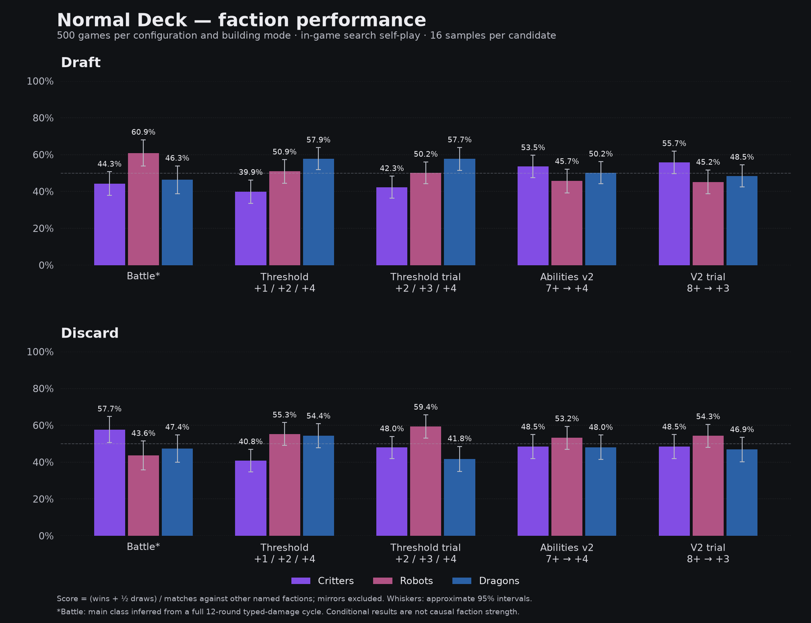
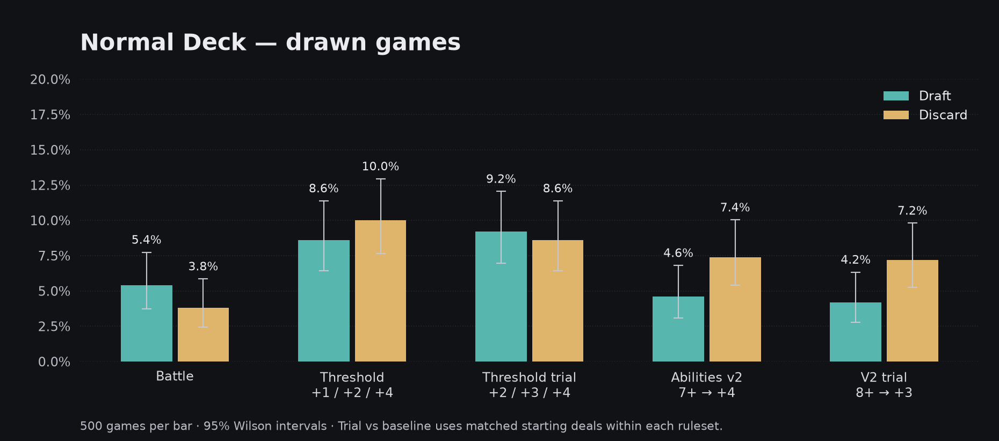
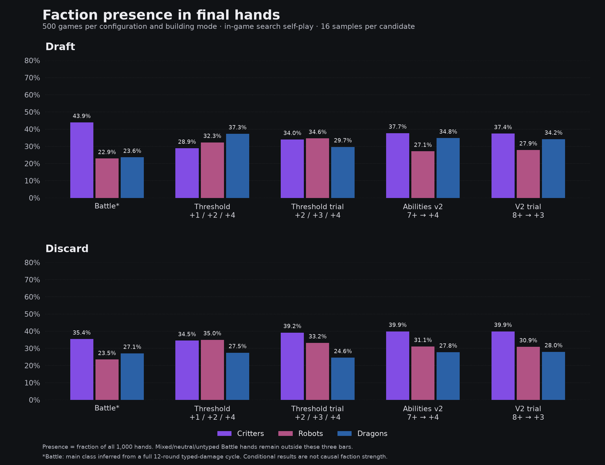
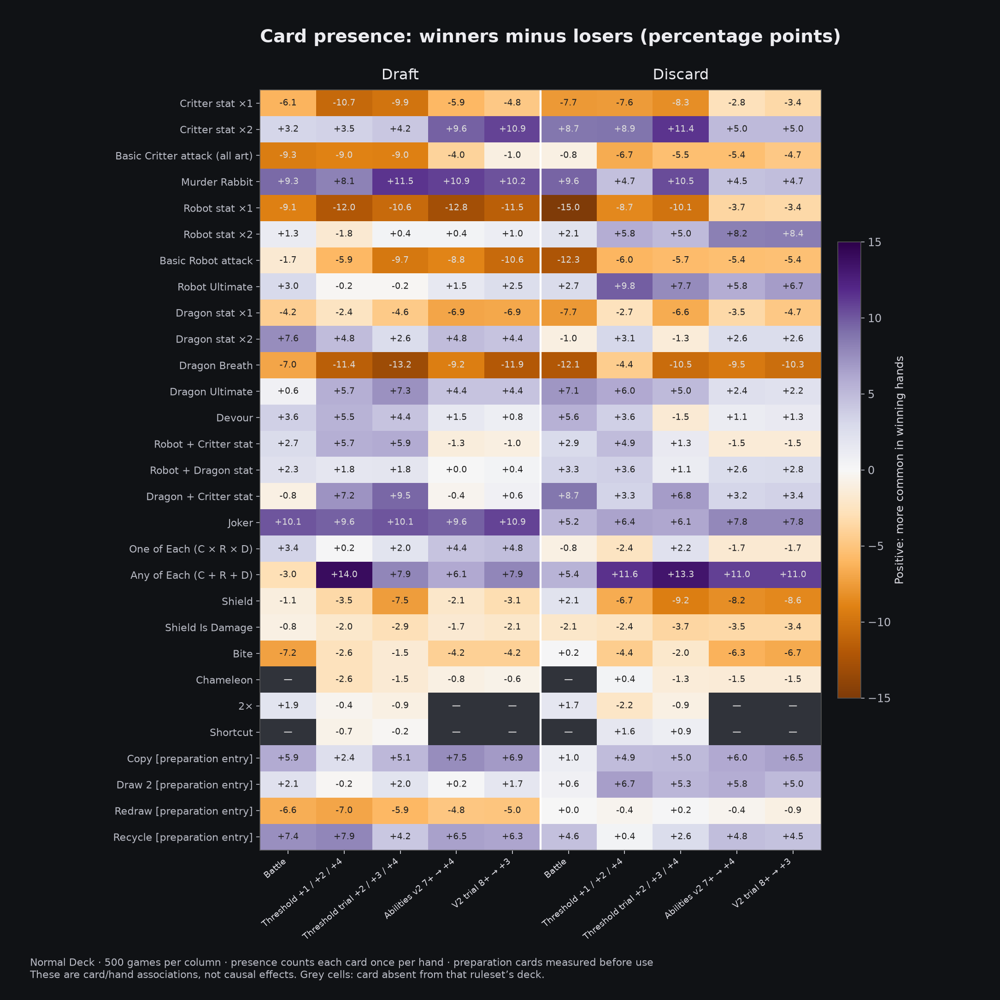

# Normal Deck balance comparison — 2026-10-21

> Naming policy (2026-10-22): **Abilities = `abilities-main`** (formerly Abilities v2). The original is **Abilities Prototype** (`abilities-prototype`), hidden and excluded from balance testing unless explicitly requested. Generic tabletop requests mean main; Threshold must be named explicitly. Historical raw IDs/paths remain unchanged. See [ruleset naming policy](RULESET_NAMES.md).

**This supersedes the earlier Wild Deck study for balance decisions. Wild is an intentionally unbalanced fun mode.**

## Verdict and next decision

Keep the current Abilities v2 Dragon rule (7+ → +4) as the working baseline. On Normal Deck, the three factions are much closer than the earlier Wild results suggested. Current v2 cross-faction scores C/R/D are 53.5/45.7/50.2% in Draft and 48.5/53.2/48.0% in Discard. All six approximate 95% intervals include 50%. This is encouraging conditional balance evidence, not proof of equal strategic value or fun.

The 8+ → +3 trial does not demonstrate an improvement: scores become 55.7/45.2/48.5% Draft and 48.5/54.3/46.9% Discard. Draws fall by only two Draft games and one Discard game; both paired uncertainty intervals include no change. No observed final v2 hand had exactly 7 Dragon power, so the cutoff increase does not change eligibility for those saved hands. Holding baseline final hands fixed, the combined trial changes only 3/500 Draft outcomes and 0/500 Discard outcomes. There is no persuasive reason here to weaken Dragons.

Original Threshold remains a plausible simple backup, but has a persistent Critter deficit in these selected hands: C/R/D scores 39.9/50.9/57.9% Draft and 40.8/55.3/54.4% Discard. Draws are 8.6% and 10.0%. If Critters are intentionally the fallback, lower conditional success is not by itself a reason to buff them; the missing question is whether that fallback was the best available decision. The +2/+3/+4 trial helps Critters, especially in Discard (48.0%), but Robots then lead at 59.4% and Dragons fall to 41.8%. Draft Critters improve only to 42.3%. This trial is not a clear all-mode upgrade, so neither trial has been adopted.

Battle is not a uniformly balanced reference either under this classification: Robot cross-faction score leads Draft at 60.9%, while Critters lead Discard at 57.7%. Battle draw rates are 5.4% Draft and 3.8% Discard. Current v2 draws less than Threshold in both modes, but does not beat Battle's Discard draw rate. Different class definitions, decks and selected hands limit direct faction comparisons with Battle.

In current v2, Critters win the most actual games: Draft C/R/D wins 190/120/167, Discard 182/156/125. Their final-hand shares are 37.7/27.1/34.8% Draft and 39.9/31.1/27.8% Discard. This is consistent with Critters being a common, usable baseline without requiring every class to take an equal number of wins.

Completed Dragon engines still pay off: Overwhelming appears in 91/1,000 Draft hands (80 wins) and only 28/1,000 Discard hands (27 wins). Those are selected successful engines, not an estimate of the bonus's causal effect. Joker + One of Each remains promising but uncommon: 18/23 wins Draft, 10/12 Discard. In v2 Draft, Murder Rabbit, double Critter stats and Joker have the clearest positive final-card presence gaps; in Discard, Any of Each, double Robot stats and Joker stand out. The full card tables retain counts and distinguish preparation cards before/after use.

A separate fairness signal worth tracking is Draft first-picker score: 59.1% in current v2 (56.1% Battle). Starters were alternated, so it does not favor one fixed seat across the study, but faction balance does not address this advantage.

Creator follow-up: agrees current v2 may already be good and asks whether original Threshold is also acceptable. No collection was stopped; all ten groups finished, and all 5,000 games were replay-verified. Current browser rules remain unchanged. Normal Deck is the mandatory balance baseline; Wild results are archival only.

## Design

- 5,000 games: Battle, Threshold, Threshold trial, Abilities v2, V2 trial × Draft/Discard × 500. Normal Deck only; printed copy counts verified in every starting deal. No Abilities Prototype runs.
- Threshold current: cutoffs 1/4/7, bonuses +1/+2/+4. Trial: same cutoffs, bonuses +2/+3/+4. V2 current: Dragon power7+ → +4. Trial: Dragon power8+ → +3. Other rules unchanged. Trials are isolated research processes, not adopted browser defaults.
- Both players use the actual in-game sampled-world search, fixed16 samples/candidate, including preparation lookahead. Search makes decisions for each ruleset; Battle has independent native round-combat self-play. 256-world rechecks of selected decisions are diagnostics, not extra played games.
- Draft first picker alternates. Discard uses the existing sequential local-AI flow and existing recycle-pile semantics. First-seat outcomes are reported; online simultaneous Discard and optimal human play are not established by this study.
- Current/trial variants share starting deals and planning seeds within a ruleset. Across Battle/Threshold/V2, decks differ (70/72/70 cards and different special cards), so equal seeds do not imply identical starting hands. This is a comparison of playable systems, not an isolated ability-effect experiment.
- Tabletop faction is its chosen main type. Battle has no chosen faction: the report uses largest typed pre-shield damage over one full12-round cooldown cycle, including doubling. One of Each is tagged Robot for consistency with tabletop. Equal typed leaders remain mixed; neutral-only and powerless hands are separate. This proxy is independent of opponent and actual fight length, but is not identical to a tabletop main-type choice.
- Cross-faction score = (wins + half draws) / matches against either other named faction. Mirrors and mixed/neutral/untyped opponents are excluded. Approximate95% intervals use one observation per included match for each faction. These are conditional associations, not proof of equal causal strength or fun.
- Card presence counts a hand once per card ID, combining artwork and physical copies. Final-hand and pre-preparation tables are separate; Copy transforms, so absence from final hands is not evidence of weakness. Activated-card groups and combinations overlap. Small groups are exploratory.

## Faction comparison



| Configuration | Building | Draws | Critter score (n) | Robot score (n) | Dragon score (n) | First-picker / P1 score |
|---|---|---:|---:|---:|---:|---:|
| Battle | Draft | 27/500 (5.4%) | 44.3% (218) | 60.9% (170) | 46.3% (164) | 56.1% |
| Battle | Discard | 19/500 (3.8%) | 57.7% (183) | 43.6% (149) | 47.4% (170) | 48.1% |
| Threshold | Draft | 43/500 (8.6%) | 39.9% (213) | 50.9% (219) | 57.9% (248) | 57.1% |
| Threshold | Discard | 50/500 (10.0%) | 40.8% (229) | 55.3% (227) | 54.4% (206) | 51.4% |
| Threshold +2/+3/+4 | Draft | 46/500 (9.2%) | 42.3% (234) | 50.2% (254) | 57.7% (228) | 56.4% |
| Threshold +2/+3/+4 | Discard | 43/500 (8.6%) | 48.0% (245) | 59.4% (219) | 41.8% (188) | 49.1% |
| V2: 7+ → +4 | Draft | 23/500 (4.6%) | 53.5% (256) | 45.7% (219) | 50.2% (259) | 59.1% |
| V2: 7+ → +4 | Discard | 37/500 (7.4%) | 48.5% (229) | 53.2% (236) | 48.0% (205) | 49.9% |
| V2: 8+ → +3 | Draft | 21/500 (4.2%) | 55.7% (253) | 45.2% (219) | 48.5% (260) | 58.7% |
| V2: 8+ → +3 | Discard | 36/500 (7.2%) | 48.5% (229) | 54.3% (234) | 46.9% (207) | 50.2% |

## Draws and faction presence





Paired trial-minus-current draw-rate changes (same starting deal, both policies may then diverge):

| Rules | Building | Change | Approximate paired95% interval | Changed winner/tie labels |
|---|---|---:|---:|---:|
| threshold | draft | +0.6pp | -2.4 to +3.6pp | 170/500 |
| threshold | five-hand-discard | -1.4pp | -4.9 to +2.1pp | 165/500 |
| abilitiesv2 | draft | -0.4pp | -1.4 to +0.6pp | 25/500 |
| abilitiesv2 | five-hand-discard | -0.2pp | -0.6 to +0.2pp | 4/500 |

## Mechanical effect on unchanged baseline hands

Rescore the baseline final hands under trial values, using each ruleset’s automatic conversion and main-type selection. Preparation/drafting/discard decisions are held fixed. This is not additional self-play.

| Rules | Building | Changed outcomes | Draws before → after | Hands with changed score |
|---|---|---:|---:|---:|
| threshold | draft | 34/500 | 43 → 38 | 576/1000 |
| threshold | five-hand-discard | 35/500 | 50 → 39 | 590/1000 |
| abilitiesv2 | draft | 3/500 | 23 → 22 | 91/1000 |
| abilitiesv2 | five-hand-discard | 0/500 | 37 → 37 | 28/1000 |

## Card overview



## Battle — Draft

500 games; 473 winning hands, 473 losing hands, 54 drawn hands. Critter tiebreak wins: 0.

| Main faction | Hands | Wins / draws / losses | Share of all wins | Win when played | Cross-faction score [95% interval] |
|---|---:|---:|---:|---:|---:|
| critter | 439 | 205 / 31 / 203 | 43.3% | 46.7% | 44.3% [37.8%, 50.7%] |
| robot | 229 | 128 / 14 / 87 | 27.1% | 55.9% | 60.9% [53.7%, 68.0%] |
| dragon | 236 | 117 / 4 / 115 | 24.7% | 49.6% | 46.3% [38.8%, 53.9%] |
| mixed | 43 | 13 / 0 / 30 | 2.7% | 30.2% | — |
| neutral | 35 | 10 / 1 / 24 | 2.1% | 28.6% | — |
| untyped | 18 | 0 / 4 / 14 | 0.0% | 0.0% | — |

| Matchup | First faction wins / draws / losses | First faction score |
|---|---:|---:|
| critter vs robot | 46 / 8 / 58 | 44.6% |
| critter vs dragon | 45 / 3 / 58 | 43.9% |
| robot vs dragon | 41 / 1 / 16 | 71.6% |

| Feature | Hands | Wins / draws / losses | Win rate |
|---|---:|---:|---:|
| Joker + One of Each | 34 | 27 / 1 / 6 | 79.4% |
| Joker without One of Each | 122 | 71 / 7 / 44 | 58.2% |
| One of Each without Joker | 56 | 24 / 3 / 29 | 42.9% |
| Double Dragon + Ultimate/Devour | 53 | 42 / 1 / 10 | 79.2% |
| Five final cards | 677 | 315 / 41 / 321 | 46.5% |
| Six or more final cards | 323 | 158 / 13 / 152 | 48.9% |

### Every card in final hands

| Card | Deck copies | Hands | All | Winners | Losers | Draws | Win when held | Copies /100 hands |
|---|---:|---:|---:|---:|---:|---:|---:|---:|
| Critter stat ×1 | 7 | 363 | 36.3% | 32.8% | 38.9% | 44.4% | 42.7% | 45.9 |
| Critter stat ×2 | 2 | 267 | 26.7% | 28.1% | 24.9% | 29.6% | 49.8% | 28.9 |
| Basic Critter attack (all art) | 8 | 542 | 54.2% | 48.8% | 58.1% | 66.7% | 42.6% | 79.9 |
| Murder Rabbit | 1 | 175 | 17.5% | 22.0% | 12.7% | 20.4% | 59.4% | 18.3 |
| Robot stat ×1 | 8 | 263 | 26.3% | 22.0% | 31.1% | 22.2% | 39.5% | 32.1 |
| Robot stat ×2 | 1 | 91 | 9.1% | 10.1% | 8.9% | 1.9% | 52.7% | 9.4 |
| Basic Robot attack | 6 | 272 | 27.2% | 26.4% | 28.1% | 25.9% | 46.0% | 33.2 |
| Robot Ultimate | 1 | 128 | 12.8% | 14.4% | 11.4% | 11.1% | 53.1% | 13.4 |
| Dragon stat ×1 | 6 | 248 | 24.8% | 23.0% | 27.3% | 18.5% | 44.0% | 28.9 |
| Dragon stat ×2 | 1 | 140 | 14.0% | 18.4% | 10.8% | 3.7% | 62.1% | 14.5 |
| Dragon Breath | 8 | 307 | 30.7% | 27.7% | 34.7% | 22.2% | 42.7% | 39.0 |
| Dragon Ultimate | 1 | 129 | 12.9% | 13.5% | 12.9% | 7.4% | 49.6% | 13.9 |
| Devour | 1 | 94 | 9.4% | 11.4% | 7.8% | 5.6% | 57.4% | 9.9 |
| Robot + Critter stat | 2 | 238 | 23.8% | 25.4% | 22.6% | 20.4% | 50.4% | 26.2 |
| Robot + Dragon stat | 1 | 88 | 8.8% | 9.9% | 7.6% | 9.3% | 53.4% | 9.0 |
| Dragon + Critter stat | 2 | 243 | 24.3% | 24.3% | 25.2% | 16.7% | 47.3% | 26.1 |
| Joker | 1 | 156 | 15.6% | 20.7% | 10.6% | 14.8% | 62.8% | 16.3 |
| One of Each (C × R × D) | 1 | 90 | 9.0% | 10.8% | 7.4% | 7.4% | 56.7% | 9.1 |
| Any of Each (C + R + D) | 1 | 93 | 9.3% | 8.0% | 11.0% | 5.6% | 40.9% | 9.6 |
| Shield | 3 | 247 | 24.7% | 23.7% | 24.7% | 33.3% | 45.3% | 28.2 |
| Shield Is Damage | 1 | 65 | 6.5% | 6.1% | 7.0% | 5.6% | 44.6% | 6.8 |
| Bite | 2 | 176 | 17.6% | 14.4% | 21.6% | 11.1% | 38.6% | 19.4 |
| 2× | 1 | 106 | 10.6% | 11.0% | 9.1% | 20.4% | 49.1% | 10.6 |
| Copy | 1 | 0 | 0.0% | 0.0% | 0.0% | 0.0% | — | 0.0 |
| Draw 2 | 1 | 127 | 12.7% | 12.9% | 13.1% | 7.4% | 48.0% | 13.7 |
| Redraw | 1 | 7 | 0.7% | 1.1% | 0.2% | 1.9% | 71.4% | 0.7 |
| Recycle | 1 | 145 | 14.5% | 19.2% | 10.1% | 11.1% | 62.8% | 14.6 |

### Every card entering preparation

| Card | Hands | All | Eventual winners | Eventual losers | Win when held |
|---|---:|---:|---:|---:|---:|
| Critter stat ×1 | 329 | 32.9% | 29.0% | 35.5% | 41.6% |
| Critter stat ×2 | 258 | 25.8% | 27.1% | 24.3% | 49.6% |
| Basic Critter attack (all art) | 504 | 50.4% | 45.5% | 53.9% | 42.7% |
| Murder Rabbit | 170 | 17.0% | 23.0% | 11.0% | 64.1% |
| Robot stat ×1 | 205 | 20.5% | 18.4% | 23.0% | 42.4% |
| Robot stat ×2 | 87 | 8.7% | 10.4% | 7.8% | 56.3% |
| Basic Robot attack | 210 | 21.0% | 20.1% | 22.2% | 45.2% |
| Robot Ultimate | 109 | 10.9% | 12.9% | 9.3% | 56.0% |
| Dragon stat ×1 | 200 | 20.0% | 18.0% | 22.4% | 42.5% |
| Dragon stat ×2 | 128 | 12.8% | 15.9% | 10.6% | 58.6% |
| Dragon Breath | 229 | 22.9% | 20.3% | 26.2% | 41.9% |
| Dragon Ultimate | 114 | 11.4% | 12.5% | 10.8% | 51.8% |
| Devour | 85 | 8.5% | 9.3% | 8.0% | 51.8% |
| Robot + Critter stat | 225 | 22.5% | 23.0% | 22.2% | 48.4% |
| Robot + Dragon stat | 78 | 7.8% | 8.5% | 7.2% | 51.3% |
| Dragon + Critter stat | 231 | 23.1% | 22.8% | 23.9% | 46.8% |
| Joker | 145 | 14.5% | 18.2% | 10.8% | 59.3% |
| One of Each (C × R × D) | 71 | 7.1% | 8.5% | 5.7% | 56.3% |
| Any of Each (C + R + D) | 81 | 8.1% | 6.6% | 10.1% | 38.3% |
| Shield | 213 | 21.3% | 19.7% | 21.8% | 43.7% |
| Shield Is Damage | 60 | 6.0% | 5.9% | 5.9% | 46.7% |
| Bite | 159 | 15.9% | 13.3% | 19.2% | 39.6% |
| 2× | 94 | 9.4% | 9.7% | 8.0% | 48.9% |
| Copy | 154 | 15.4% | 18.0% | 12.1% | 55.2% |
| Draw 2 | 132 | 13.2% | 14.6% | 12.5% | 52.3% |
| Redraw | 81 | 8.1% | 5.1% | 11.6% | 29.6% |
| Recycle | 157 | 15.7% | 19.5% | 12.1% | 58.6% |

### Actual preparation use

| Card activated at least once | Hands | Wins / draws / losses | Win rate |
|---|---:|---:|---:|
| Copy | 164 | 94 / 12 / 58 | 57.3% |
| Draw 2 | 147 | 74 / 4 / 69 | 50.3% |
| Redraw | 90 | 28 / 3 / 59 | 31.1% |
| Recycle | 168 | 100 / 9 / 59 | 59.5% |
## Battle — Discard

500 games; 481 winning hands, 481 losing hands, 38 drawn hands. Critter tiebreak wins: 0.

| Main faction | Hands | Wins / draws / losses | Share of all wins | Win when played | Cross-faction score [95% interval] |
|---|---:|---:|---:|---:|---:|
| critter | 354 | 193 / 9 / 152 | 40.1% | 54.5% | 57.7% [50.6%, 64.7%] |
| robot | 235 | 112 / 12 / 111 | 23.3% | 47.7% | 43.6% [35.8%, 51.4%] |
| dragon | 271 | 136 / 10 / 125 | 28.3% | 50.2% | 47.4% [39.9%, 54.8%] |
| mixed | 54 | 19 / 4 / 31 | 4.0% | 35.2% | — |
| neutral | 50 | 21 / 1 / 28 | 4.4% | 42.0% | — |
| untyped | 36 | 0 / 2 / 34 | 0.0% | 0.0% | — |

| Matchup | First faction wins / draws / losses | First faction score |
|---|---:|---:|
| critter vs robot | 48 / 4 / 29 | 61.7% |
| critter vs dragon | 55 / 1 / 46 | 54.4% |
| robot vs dragon | 33 / 2 / 33 | 50.0% |

| Feature | Hands | Wins / draws / losses | Win rate |
|---|---:|---:|---:|
| Joker + One of Each | 10 | 6 / 0 / 4 | 60.0% |
| Joker without One of Each | 105 | 63 / 2 / 40 | 60.0% |
| One of Each without Joker | 30 | 12 / 0 / 18 | 40.0% |
| Double Dragon + Ultimate/Devour | 20 | 16 / 0 / 4 | 80.0% |
| Five final cards | 756 | 357 / 32 / 367 | 47.2% |
| Six or more final cards | 244 | 124 / 6 / 114 | 50.8% |

### Every card in final hands

| Card | Deck copies | Hands | All | Winners | Losers | Draws | Win when held | Copies /100 hands |
|---|---:|---:|---:|---:|---:|---:|---:|---:|
| Critter stat ×1 | 7 | 389 | 38.9% | 35.6% | 43.2% | 26.3% | 44.0% | 46.9 |
| Critter stat ×2 | 2 | 208 | 20.8% | 25.2% | 16.4% | 21.1% | 58.2% | 22.5 |
| Basic Critter attack (all art) | 8 | 536 | 53.6% | 53.6% | 54.5% | 42.1% | 48.1% | 69.3 |
| Murder Rabbit | 1 | 137 | 13.7% | 18.7% | 9.1% | 7.9% | 65.7% | 14.2 |
| Robot stat ×1 | 8 | 371 | 37.1% | 28.9% | 43.9% | 55.3% | 37.5% | 44.7 |
| Robot stat ×2 | 1 | 81 | 8.1% | 8.7% | 6.7% | 18.4% | 51.9% | 8.1 |
| Basic Robot attack | 6 | 333 | 33.3% | 26.6% | 38.9% | 47.4% | 38.4% | 40.9 |
| Robot Ultimate | 1 | 113 | 11.3% | 12.9% | 10.2% | 5.3% | 54.9% | 11.7 |
| Dragon stat ×1 | 6 | 310 | 31.0% | 27.4% | 35.1% | 23.7% | 42.6% | 37.0 |
| Dragon stat ×2 | 1 | 119 | 11.9% | 11.4% | 12.5% | 10.5% | 46.2% | 12.0 |
| Dragon Breath | 8 | 405 | 40.5% | 33.9% | 45.9% | 55.3% | 40.2% | 50.4 |
| Dragon Ultimate | 1 | 115 | 11.5% | 15.2% | 8.1% | 7.9% | 63.5% | 11.8 |
| Devour | 1 | 88 | 8.8% | 11.9% | 6.2% | 2.6% | 64.8% | 8.8 |
| Robot + Critter stat | 2 | 203 | 20.3% | 22.0% | 19.1% | 13.2% | 52.2% | 21.3 |
| Robot + Dragon stat | 1 | 103 | 10.3% | 11.6% | 8.3% | 18.4% | 54.4% | 10.4 |
| Dragon + Critter stat | 2 | 207 | 20.7% | 25.4% | 16.6% | 13.2% | 58.9% | 22.2 |
| Joker | 1 | 115 | 11.5% | 14.3% | 9.1% | 5.3% | 60.0% | 11.8 |
| One of Each (C × R × D) | 1 | 40 | 4.0% | 3.7% | 4.6% | 0.0% | 45.0% | 4.0 |
| Any of Each (C + R + D) | 1 | 95 | 9.5% | 12.5% | 7.1% | 2.6% | 63.2% | 9.8 |
| Shield | 3 | 223 | 22.3% | 23.1% | 21.0% | 28.9% | 49.8% | 24.4 |
| Shield Is Damage | 1 | 44 | 4.4% | 3.3% | 5.4% | 5.3% | 36.4% | 4.5 |
| Bite | 2 | 205 | 20.5% | 21.2% | 21.0% | 5.3% | 49.8% | 22.8 |
| 2× | 1 | 70 | 7.0% | 7.9% | 6.2% | 5.3% | 54.3% | 7.0 |
| Copy | 1 | 0 | 0.0% | 0.0% | 0.0% | 0.0% | — | 0.0 |
| Draw 2 | 1 | 83 | 8.3% | 8.1% | 8.7% | 5.3% | 47.0% | 8.8 |
| Redraw | 1 | 21 | 2.1% | 2.9% | 1.5% | 0.0% | 66.7% | 2.1 |
| Recycle | 1 | 115 | 11.5% | 13.9% | 9.6% | 5.3% | 58.3% | 11.6 |

### Every card entering preparation

| Card | Hands | All | Eventual winners | Eventual losers | Win when held |
|---|---:|---:|---:|---:|---:|
| Critter stat ×1 | 348 | 34.8% | 31.2% | 39.5% | 43.1% |
| Critter stat ×2 | 201 | 20.1% | 24.7% | 15.2% | 59.2% |
| Basic Critter attack (all art) | 495 | 49.5% | 49.3% | 50.3% | 47.9% |
| Murder Rabbit | 129 | 12.9% | 17.7% | 8.5% | 65.9% |
| Robot stat ×1 | 344 | 34.4% | 27.9% | 39.9% | 39.0% |
| Robot stat ×2 | 70 | 7.0% | 7.7% | 5.6% | 52.9% |
| Basic Robot attack | 318 | 31.8% | 25.4% | 37.6% | 38.4% |
| Robot Ultimate | 108 | 10.8% | 12.1% | 10.0% | 53.7% |
| Dragon stat ×1 | 269 | 26.9% | 22.7% | 31.2% | 40.5% |
| Dragon stat ×2 | 109 | 10.9% | 9.8% | 12.1% | 43.1% |
| Dragon Breath | 382 | 38.2% | 32.2% | 43.2% | 40.6% |
| Dragon Ultimate | 109 | 10.9% | 14.8% | 7.3% | 65.1% |
| Devour | 85 | 8.5% | 11.0% | 6.4% | 62.4% |
| Robot + Critter stat | 192 | 19.2% | 21.2% | 17.9% | 53.1% |
| Robot + Dragon stat | 100 | 10.0% | 11.0% | 8.3% | 53.0% |
| Dragon + Critter stat | 198 | 19.8% | 24.1% | 16.0% | 58.6% |
| Joker | 109 | 10.9% | 13.5% | 8.7% | 59.6% |
| One of Each (C × R × D) | 38 | 3.8% | 3.3% | 4.6% | 42.1% |
| Any of Each (C + R + D) | 86 | 8.6% | 10.8% | 6.9% | 60.5% |
| Shield | 197 | 19.7% | 20.2% | 18.7% | 49.2% |
| Shield Is Damage | 38 | 3.8% | 2.3% | 5.0% | 28.9% |
| Bite | 196 | 19.6% | 19.5% | 20.8% | 48.0% |
| 2× | 65 | 6.5% | 7.7% | 5.4% | 56.9% |
| Copy | 83 | 8.3% | 8.7% | 7.7% | 50.6% |
| Draw 2 | 77 | 7.7% | 8.1% | 7.5% | 50.6% |
| Redraw | 84 | 8.4% | 8.5% | 8.5% | 48.8% |
| Recycle | 117 | 11.7% | 14.1% | 9.6% | 58.1% |

### Actual preparation use

| Card activated at least once | Hands | Wins / draws / losses | Win rate |
|---|---:|---:|---:|
| Copy | 93 | 47 / 4 / 42 | 50.5% |
| Draw 2 | 88 | 44 / 2 / 42 | 50.0% |
| Redraw | 74 | 34 / 2 / 38 | 45.9% |
| Recycle | 127 | 73 / 3 / 51 | 57.5% |
## Threshold — Draft

500 games; 457 winning hands, 457 losing hands, 86 drawn hands. Critter tiebreak wins: 0.

| Main faction | Hands | Wins / draws / losses | Share of all wins | Win when played | Cross-faction score [95% interval] |
|---|---:|---:|---:|---:|---:|
| critter | 289 | 111 / 30 / 148 | 24.3% | 38.4% | 39.9% [33.6%, 46.2%] |
| robot | 323 | 151 / 29 / 143 | 33.0% | 46.7% | 50.9% [44.5%, 57.3%] |
| dragon | 373 | 195 / 25 / 153 | 42.7% | 52.3% | 57.9% [51.9%, 63.8%] |
| mixed | 0 | 0 / 0 / 0 | 0.0% | — | — |
| neutral | 0 | 0 / 0 / 0 | 0.0% | — | — |
| untyped | 15 | 0 / 2 / 13 | 0.0% | 0.0% | — |

| Matchup | First faction wins / draws / losses | First faction score |
|---|---:|---:|
| critter vs robot | 41 / 8 / 43 | 48.9% |
| critter vs dragon | 36 / 8 / 77 | 33.1% |
| robot vs dragon | 60 / 9 / 58 | 50.8% |

| Feature | Hands | Wins / draws / losses | Win rate |
|---|---:|---:|---:|
| Joker + One of Each | 25 | 21 / 0 / 4 | 84.0% |
| Joker without One of Each | 134 | 75 / 11 / 48 | 56.0% |
| One of Each without Joker | 71 | 24 / 7 / 40 | 33.8% |
| Double Dragon + Ultimate/Devour | 39 | 32 / 2 / 5 | 82.1% |
| Five final cards | 668 | 310 / 59 / 299 | 46.4% |
| Six or more final cards | 332 | 147 / 27 / 158 | 44.3% |

### Every card in final hands

| Card | Deck copies | Hands | All | Winners | Losers | Draws | Win when held | Copies /100 hands |
|---|---:|---:|---:|---:|---:|---:|---:|---:|
| Critter stat ×1 | 7 | 263 | 26.3% | 20.6% | 31.3% | 30.2% | 35.7% | 32.4 |
| Critter stat ×2 | 2 | 216 | 21.6% | 23.9% | 20.4% | 16.3% | 50.5% | 24.2 |
| Basic Critter attack (all art) | 8 | 371 | 37.1% | 33.0% | 42.0% | 32.6% | 40.7% | 50.4 |
| Murder Rabbit | 1 | 156 | 15.6% | 19.7% | 11.6% | 15.1% | 57.7% | 16.8 |
| Robot stat ×1 | 8 | 326 | 32.6% | 26.0% | 38.1% | 38.4% | 36.5% | 40.2 |
| Robot stat ×2 | 1 | 120 | 12.0% | 11.2% | 12.9% | 11.6% | 42.5% | 12.2 |
| Basic Robot attack | 6 | 299 | 29.9% | 26.7% | 32.6% | 32.6% | 40.8% | 39.1 |
| Robot Ultimate | 1 | 140 | 14.0% | 13.8% | 14.0% | 15.1% | 45.0% | 14.5 |
| Dragon stat ×1 | 6 | 395 | 39.5% | 38.5% | 40.9% | 37.2% | 44.6% | 48.3 |
| Dragon stat ×2 | 1 | 150 | 15.0% | 17.3% | 12.5% | 16.3% | 52.7% | 15.4 |
| Dragon Breath | 8 | 396 | 39.6% | 34.6% | 46.0% | 32.6% | 39.9% | 52.3 |
| Dragon Ultimate | 1 | 142 | 14.2% | 17.7% | 12.0% | 7.0% | 57.0% | 14.6 |
| Devour | 1 | 147 | 14.7% | 17.7% | 12.3% | 11.6% | 55.1% | 15.2 |
| Robot + Critter stat | 2 | 225 | 22.5% | 25.4% | 19.7% | 22.1% | 51.6% | 25.1 |
| Robot + Dragon stat | 1 | 148 | 14.8% | 15.8% | 14.0% | 14.0% | 48.6% | 15.5 |
| Dragon + Critter stat | 2 | 270 | 27.0% | 30.2% | 23.0% | 31.4% | 51.1% | 29.5 |
| Joker | 1 | 159 | 15.9% | 21.0% | 11.4% | 12.8% | 60.4% | 17.3 |
| One of Each (C × R × D) | 1 | 96 | 9.6% | 9.8% | 9.6% | 8.1% | 46.9% | 9.6 |
| Any of Each (C + R + D) | 1 | 175 | 17.5% | 24.9% | 10.9% | 12.8% | 65.1% | 18.4 |
| Shield | 3 | 128 | 12.8% | 10.7% | 14.2% | 16.3% | 38.3% | 14.0 |
| Shield Is Damage | 1 | 22 | 2.2% | 1.1% | 3.1% | 3.5% | 22.7% | 2.2 |
| Bite | 2 | 80 | 8.0% | 6.3% | 9.0% | 11.6% | 36.2% | 8.4 |
| Chameleon | 1 | 36 | 3.6% | 2.4% | 5.0% | 2.3% | 30.6% | 3.6 |
| 2× | 1 | 34 | 3.4% | 3.1% | 3.5% | 4.7% | 41.2% | 3.5 |
| Shortcut | 1 | 83 | 8.3% | 8.1% | 8.8% | 7.0% | 44.6% | 8.3 |
| Copy | 1 | 0 | 0.0% | 0.0% | 0.0% | 0.0% | — | 0.0 |
| Draw 2 | 1 | 155 | 15.5% | 15.3% | 16.6% | 10.5% | 45.2% | 17.8 |
| Redraw | 1 | 9 | 0.9% | 1.8% | 0.0% | 1.2% | 88.9% | 0.9 |
| Recycle | 1 | 129 | 12.9% | 16.4% | 8.3% | 18.6% | 58.1% | 13.5 |

### Every card entering preparation

| Card | Hands | All | Eventual winners | Eventual losers | Win when held |
|---|---:|---:|---:|---:|---:|
| Critter stat ×1 | 206 | 20.6% | 15.8% | 24.7% | 35.0% |
| Critter stat ×2 | 208 | 20.8% | 22.8% | 19.9% | 50.0% |
| Basic Critter attack (all art) | 321 | 32.1% | 29.8% | 35.0% | 42.4% |
| Murder Rabbit | 153 | 15.3% | 18.8% | 11.8% | 56.2% |
| Robot stat ×1 | 270 | 27.0% | 22.8% | 30.6% | 38.5% |
| Robot stat ×2 | 118 | 11.8% | 10.5% | 12.9% | 40.7% |
| Basic Robot attack | 260 | 26.0% | 22.3% | 29.8% | 39.2% |
| Robot Ultimate | 129 | 12.9% | 12.7% | 13.1% | 45.0% |
| Dragon stat ×1 | 347 | 34.7% | 34.1% | 35.2% | 45.0% |
| Dragon stat ×2 | 143 | 14.3% | 16.6% | 11.8% | 53.1% |
| Dragon Breath | 333 | 33.3% | 30.2% | 37.0% | 41.4% |
| Dragon Ultimate | 141 | 14.1% | 17.3% | 12.3% | 56.0% |
| Devour | 135 | 13.5% | 16.2% | 11.2% | 54.8% |
| Robot + Critter stat | 198 | 19.8% | 21.0% | 18.8% | 48.5% |
| Robot + Dragon stat | 140 | 14.0% | 14.2% | 13.1% | 46.4% |
| Dragon + Critter stat | 255 | 25.5% | 27.8% | 22.3% | 49.8% |
| Joker | 157 | 15.7% | 19.9% | 12.3% | 58.0% |
| One of Each (C × R × D) | 73 | 7.3% | 8.3% | 6.6% | 52.1% |
| Any of Each (C + R + D) | 169 | 16.9% | 23.6% | 10.9% | 63.9% |
| Shield | 95 | 9.5% | 7.2% | 10.9% | 34.7% |
| Shield Is Damage | 4 | 0.4% | 0.2% | 0.7% | 25.0% |
| Bite | 58 | 5.8% | 4.4% | 6.8% | 34.5% |
| Chameleon | 20 | 2.0% | 1.5% | 2.4% | 35.0% |
| 2× | 22 | 2.2% | 2.0% | 2.4% | 40.9% |
| Shortcut | 75 | 7.5% | 7.0% | 8.1% | 42.7% |
| Copy | 166 | 16.6% | 17.7% | 15.3% | 48.8% |
| Draw 2 | 154 | 15.4% | 15.5% | 15.8% | 46.1% |
| Redraw | 77 | 7.7% | 4.4% | 11.4% | 26.0% |
| Recycle | 146 | 14.6% | 18.2% | 10.3% | 56.8% |

### Actual preparation use

| Card activated at least once | Hands | Wins / draws / losses | Win rate |
|---|---:|---:|---:|
| Copy | 179 | 88 / 16 / 75 | 49.2% |
| Draw 2 | 169 | 75 / 12 / 82 | 44.4% |
| Redraw | 87 | 19 / 6 / 62 | 21.8% |
| Recycle | 153 | 86 / 18 / 49 | 56.2% |

Same-final-hand Battle winner agreement: 74.9% of 387 eligible games (tabletop-only cards excluded). This is an additional mechanical reference, not the native Battle self-play comparison above.
## Threshold — Discard

500 games; 450 winning hands, 450 losing hands, 100 drawn hands. Critter tiebreak wins: 0.

| Main faction | Hands | Wins / draws / losses | Share of all wins | Win when played | Cross-faction score [95% interval] |
|---|---:|---:|---:|---:|---:|
| critter | 345 | 134 / 43 / 168 | 29.8% | 38.8% | 40.8% [34.7%, 46.9%] |
| robot | 350 | 177 / 31 / 142 | 39.3% | 50.6% | 55.3% [49.1%, 61.5%] |
| dragon | 275 | 139 / 24 / 112 | 30.9% | 50.5% | 54.4% [47.9%, 60.8%] |
| mixed | 0 | 0 / 0 / 0 | 0.0% | — | — |
| neutral | 0 | 0 / 0 / 0 | 0.0% | — | — |
| untyped | 30 | 0 / 2 / 28 | 0.0% | 0.0% | — |

| Matchup | First faction wins / draws / losses | First faction score |
|---|---:|---:|
| critter vs robot | 45 / 10 / 70 | 40.0% |
| critter vs dragon | 39 / 9 / 56 | 41.8% |
| robot vs dragon | 45 / 11 / 46 | 49.5% |

| Feature | Hands | Wins / draws / losses | Win rate |
|---|---:|---:|---:|
| Joker + One of Each | 6 | 5 / 0 / 1 | 83.3% |
| Joker without One of Each | 105 | 59 / 12 / 34 | 56.2% |
| One of Each without Joker | 44 | 12 / 5 / 27 | 27.3% |
| Double Dragon + Ultimate/Devour | 29 | 24 / 1 / 4 | 82.8% |
| Five final cards | 725 | 316 / 70 / 339 | 43.6% |
| Six or more final cards | 275 | 134 / 30 / 111 | 48.7% |

### Every card in final hands

| Card | Deck copies | Hands | All | Winners | Losers | Draws | Win when held | Copies /100 hands |
|---|---:|---:|---:|---:|---:|---:|---:|---:|
| Critter stat ×1 | 7 | 358 | 35.8% | 31.1% | 38.7% | 44.0% | 39.1% | 42.4 |
| Critter stat ×2 | 2 | 210 | 21.0% | 26.2% | 17.3% | 14.0% | 56.2% | 22.3 |
| Basic Critter attack (all art) | 8 | 458 | 45.8% | 41.3% | 48.0% | 56.0% | 40.6% | 60.8 |
| Murder Rabbit | 1 | 122 | 12.2% | 14.2% | 9.6% | 15.0% | 52.5% | 12.4 |
| Robot stat ×1 | 8 | 385 | 38.5% | 33.8% | 42.4% | 42.0% | 39.5% | 48.3 |
| Robot stat ×2 | 1 | 104 | 10.4% | 14.0% | 8.2% | 4.0% | 60.6% | 10.5 |
| Basic Robot attack | 6 | 349 | 34.9% | 32.0% | 38.0% | 34.0% | 41.3% | 43.8 |
| Robot Ultimate | 1 | 136 | 13.6% | 18.4% | 8.7% | 14.0% | 61.0% | 14.1 |
| Dragon stat ×1 | 6 | 341 | 34.1% | 32.0% | 34.7% | 41.0% | 42.2% | 39.2 |
| Dragon stat ×2 | 1 | 102 | 10.2% | 11.8% | 8.7% | 10.0% | 52.0% | 10.7 |
| Dragon Breath | 8 | 381 | 38.1% | 36.0% | 40.4% | 37.0% | 42.5% | 48.4 |
| Dragon Ultimate | 1 | 117 | 11.7% | 14.9% | 8.9% | 10.0% | 57.3% | 12.1 |
| Devour | 1 | 109 | 10.9% | 12.9% | 9.3% | 9.0% | 53.2% | 11.4 |
| Robot + Critter stat | 2 | 207 | 20.7% | 23.6% | 18.7% | 17.0% | 51.2% | 22.3 |
| Robot + Dragon stat | 1 | 112 | 11.2% | 13.3% | 9.8% | 8.0% | 53.6% | 11.5 |
| Dragon + Critter stat | 2 | 226 | 22.6% | 24.7% | 21.3% | 19.0% | 49.1% | 24.3 |
| Joker | 1 | 111 | 11.1% | 14.2% | 7.8% | 12.0% | 57.7% | 11.6 |
| One of Each (C × R × D) | 1 | 50 | 5.0% | 3.8% | 6.2% | 5.0% | 34.0% | 5.0 |
| Any of Each (C + R + D) | 1 | 162 | 16.2% | 22.2% | 10.7% | 14.0% | 61.7% | 16.7 |
| Shield | 3 | 181 | 18.1% | 14.7% | 21.3% | 19.0% | 36.5% | 19.4 |
| Shield Is Damage | 1 | 35 | 3.5% | 2.4% | 4.9% | 2.0% | 31.4% | 3.5 |
| Bite | 2 | 125 | 12.5% | 10.2% | 14.7% | 13.0% | 36.8% | 13.2 |
| Chameleon | 1 | 50 | 5.0% | 5.3% | 4.9% | 4.0% | 48.0% | 5.0 |
| 2× | 1 | 42 | 4.2% | 3.3% | 5.6% | 2.0% | 35.7% | 4.2 |
| Shortcut | 1 | 88 | 8.8% | 9.6% | 8.0% | 9.0% | 48.9% | 8.8 |
| Copy | 1 | 0 | 0.0% | 0.0% | 0.0% | 0.0% | — | 0.0 |
| Draw 2 | 1 | 113 | 11.3% | 14.2% | 8.4% | 11.0% | 56.6% | 11.8 |
| Redraw | 1 | 18 | 1.8% | 1.3% | 2.2% | 2.0% | 33.3% | 1.8 |
| Recycle | 1 | 112 | 11.2% | 12.0% | 10.4% | 11.0% | 48.2% | 11.4 |

### Every card entering preparation

| Card | Hands | All | Eventual winners | Eventual losers | Win when held |
|---|---:|---:|---:|---:|---:|
| Critter stat ×1 | 328 | 32.8% | 28.0% | 36.2% | 38.4% |
| Critter stat ×2 | 187 | 18.7% | 24.0% | 15.3% | 57.8% |
| Basic Critter attack (all art) | 410 | 41.0% | 34.4% | 45.3% | 37.8% |
| Murder Rabbit | 108 | 10.8% | 12.7% | 9.1% | 52.8% |
| Robot stat ×1 | 348 | 34.8% | 29.3% | 39.6% | 37.9% |
| Robot stat ×2 | 95 | 9.5% | 12.4% | 7.8% | 58.9% |
| Basic Robot attack | 310 | 31.0% | 27.8% | 34.4% | 40.3% |
| Robot Ultimate | 124 | 12.4% | 16.2% | 8.4% | 58.9% |
| Dragon stat ×1 | 314 | 31.4% | 28.9% | 32.7% | 41.4% |
| Dragon stat ×2 | 99 | 9.9% | 10.9% | 8.4% | 49.5% |
| Dragon Breath | 349 | 34.9% | 32.4% | 37.3% | 41.8% |
| Dragon Ultimate | 99 | 9.9% | 12.0% | 8.4% | 54.5% |
| Devour | 108 | 10.8% | 12.2% | 10.2% | 50.9% |
| Robot + Critter stat | 189 | 18.9% | 20.7% | 17.6% | 49.2% |
| Robot + Dragon stat | 105 | 10.5% | 12.0% | 9.6% | 51.4% |
| Dragon + Critter stat | 212 | 21.2% | 22.9% | 20.0% | 48.6% |
| Joker | 104 | 10.4% | 13.1% | 7.8% | 56.7% |
| One of Each (C × R × D) | 40 | 4.0% | 3.6% | 4.4% | 40.0% |
| Any of Each (C + R + D) | 145 | 14.5% | 20.0% | 10.0% | 62.1% |
| Shield | 173 | 17.3% | 13.8% | 19.8% | 35.8% |
| Shield Is Damage | 28 | 2.8% | 1.6% | 4.4% | 25.0% |
| Bite | 99 | 9.9% | 7.3% | 12.0% | 33.3% |
| Chameleon | 35 | 3.5% | 3.6% | 3.8% | 45.7% |
| 2× | 37 | 3.7% | 3.1% | 4.7% | 37.8% |
| Shortcut | 82 | 8.2% | 8.9% | 7.6% | 48.8% |
| Copy | 98 | 9.8% | 12.2% | 7.3% | 56.1% |
| Draw 2 | 116 | 11.6% | 15.1% | 8.4% | 58.6% |
| Redraw | 89 | 8.9% | 8.4% | 8.9% | 42.7% |
| Recycle | 113 | 11.3% | 11.3% | 10.9% | 45.1% |

### Actual preparation use

| Card activated at least once | Hands | Wins / draws / losses | Win rate |
|---|---:|---:|---:|
| Copy | 112 | 62 / 11 / 39 | 55.4% |
| Draw 2 | 124 | 73 / 11 / 40 | 58.9% |
| Redraw | 81 | 37 / 11 / 33 | 45.7% |
| Recycle | 124 | 59 / 14 / 51 | 47.6% |

Same-final-hand Battle winner agreement: 76.5% of 371 eligible games (tabletop-only cards excluded). This is an additional mechanical reference, not the native Battle self-play comparison above.
## Threshold +2/+3/+4 — Draft

500 games; 454 winning hands, 454 losing hands, 92 drawn hands. Critter tiebreak wins: 0.

| Main faction | Hands | Wins / draws / losses | Share of all wins | Win when played | Cross-faction score [95% interval] |
|---|---:|---:|---:|---:|---:|
| critter | 340 | 139 / 35 / 166 | 30.6% | 40.9% | 42.3% [36.3%, 48.3%] |
| robot | 346 | 157 / 33 / 156 | 34.6% | 45.4% | 50.2% [44.3%, 56.1%] |
| dragon | 297 | 158 / 21 / 118 | 34.8% | 53.2% | 57.7% [51.5%, 63.9%] |
| mixed | 0 | 0 / 0 / 0 | 0.0% | — | — |
| neutral | 0 | 0 / 0 / 0 | 0.0% | — | — |
| untyped | 17 | 0 / 3 / 14 | 0.0% | 0.0% | — |

| Matchup | First faction wins / draws / losses | First faction score |
|---|---:|---:|
| critter vs robot | 53 / 15 / 62 | 46.5% |
| critter vs dragon | 35 / 7 / 62 | 37.0% |
| robot vs dragon | 54 / 8 / 62 | 46.8% |

| Feature | Hands | Wins / draws / losses | Win rate |
|---|---:|---:|---:|
| Joker + One of Each | 22 | 20 / 1 / 1 | 90.9% |
| Joker without One of Each | 134 | 74 / 13 / 47 | 55.2% |
| One of Each without Joker | 62 | 21 / 10 / 31 | 33.9% |
| Double Dragon + Ultimate/Devour | 41 | 33 / 4 / 4 | 80.5% |
| Five final cards | 659 | 309 / 51 / 299 | 46.9% |
| Six or more final cards | 341 | 145 / 41 / 155 | 42.5% |

### Every card in final hands

| Card | Deck copies | Hands | All | Winners | Losers | Draws | Win when held | Copies /100 hands |
|---|---:|---:|---:|---:|---:|---:|---:|---:|
| Critter stat ×1 | 7 | 303 | 30.3% | 24.9% | 34.8% | 34.8% | 37.3% | 36.8 |
| Critter stat ×2 | 2 | 246 | 24.6% | 26.0% | 21.8% | 31.5% | 48.0% | 27.9 |
| Basic Critter attack (all art) | 8 | 415 | 41.5% | 36.8% | 45.8% | 43.5% | 40.2% | 58.5 |
| Murder Rabbit | 1 | 163 | 16.3% | 22.5% | 11.0% | 12.0% | 62.6% | 17.9 |
| Robot stat ×1 | 8 | 328 | 32.8% | 27.3% | 37.9% | 34.8% | 37.8% | 41.9 |
| Robot stat ×2 | 1 | 121 | 12.1% | 12.6% | 12.1% | 9.8% | 47.1% | 12.4 |
| Basic Robot attack | 6 | 323 | 32.3% | 28.0% | 37.7% | 27.2% | 39.3% | 41.7 |
| Robot Ultimate | 1 | 137 | 13.7% | 13.2% | 13.4% | 17.4% | 43.8% | 14.7 |
| Dragon stat ×1 | 6 | 321 | 32.1% | 30.2% | 34.8% | 28.3% | 42.7% | 38.4 |
| Dragon stat ×2 | 1 | 143 | 14.3% | 15.6% | 13.0% | 14.1% | 49.7% | 14.8 |
| Dragon Breath | 8 | 329 | 32.9% | 25.8% | 39.0% | 38.0% | 35.6% | 41.1 |
| Dragon Ultimate | 1 | 140 | 14.0% | 18.3% | 11.0% | 7.6% | 59.3% | 14.8 |
| Devour | 1 | 126 | 12.6% | 15.0% | 10.6% | 10.9% | 54.0% | 13.4 |
| Robot + Critter stat | 2 | 236 | 23.6% | 25.6% | 19.6% | 33.7% | 49.2% | 25.6 |
| Robot + Dragon stat | 1 | 145 | 14.5% | 15.4% | 13.7% | 14.1% | 48.3% | 14.9 |
| Dragon + Critter stat | 2 | 253 | 25.3% | 29.7% | 20.3% | 28.3% | 53.4% | 27.5 |
| Joker | 1 | 156 | 15.6% | 20.7% | 10.6% | 15.2% | 60.3% | 16.9 |
| One of Each (C × R × D) | 1 | 84 | 8.4% | 9.0% | 7.0% | 12.0% | 48.8% | 8.4 |
| Any of Each (C + R + D) | 1 | 174 | 17.4% | 21.6% | 13.7% | 15.2% | 56.3% | 18.3 |
| Shield | 3 | 147 | 14.7% | 10.8% | 18.3% | 16.3% | 33.3% | 15.9 |
| Shield Is Damage | 1 | 28 | 2.8% | 1.3% | 4.2% | 3.3% | 21.4% | 2.8 |
| Bite | 2 | 78 | 7.8% | 7.0% | 8.6% | 7.6% | 41.0% | 8.4 |
| Chameleon | 1 | 29 | 2.9% | 2.4% | 4.0% | 0.0% | 37.9% | 2.9 |
| 2× | 1 | 61 | 6.1% | 5.9% | 6.8% | 3.3% | 44.3% | 6.5 |
| Shortcut | 1 | 65 | 6.5% | 6.4% | 6.6% | 6.5% | 44.6% | 6.5 |
| Copy | 1 | 0 | 0.0% | 0.0% | 0.0% | 0.0% | — | 0.0 |
| Draw 2 | 1 | 157 | 15.7% | 15.0% | 15.9% | 18.5% | 43.3% | 16.6 |
| Redraw | 1 | 12 | 1.2% | 1.5% | 0.2% | 4.3% | 58.3% | 1.2 |
| Recycle | 1 | 135 | 13.5% | 15.4% | 9.3% | 25.0% | 51.9% | 14.0 |

### Every card entering preparation

| Card | Hands | All | Eventual winners | Eventual losers | Win when held |
|---|---:|---:|---:|---:|---:|
| Critter stat ×1 | 246 | 24.6% | 21.4% | 28.0% | 39.4% |
| Critter stat ×2 | 232 | 23.2% | 24.9% | 20.9% | 48.7% |
| Basic Critter attack (all art) | 372 | 37.2% | 34.1% | 39.0% | 41.7% |
| Murder Rabbit | 157 | 15.7% | 20.9% | 11.2% | 60.5% |
| Robot stat ×1 | 267 | 26.7% | 23.3% | 30.2% | 39.7% |
| Robot stat ×2 | 112 | 11.2% | 11.9% | 11.0% | 48.2% |
| Basic Robot attack | 274 | 27.4% | 24.2% | 31.3% | 40.1% |
| Robot Ultimate | 131 | 13.1% | 12.3% | 13.4% | 42.7% |
| Dragon stat ×1 | 287 | 28.7% | 26.9% | 31.5% | 42.5% |
| Dragon stat ×2 | 141 | 14.1% | 15.6% | 13.0% | 50.4% |
| Dragon Breath | 281 | 28.1% | 23.1% | 33.3% | 37.4% |
| Dragon Ultimate | 135 | 13.5% | 17.6% | 10.6% | 59.3% |
| Devour | 121 | 12.1% | 14.3% | 9.9% | 53.7% |
| Robot + Critter stat | 215 | 21.5% | 22.5% | 18.9% | 47.4% |
| Robot + Dragon stat | 135 | 13.5% | 14.3% | 13.0% | 48.1% |
| Dragon + Critter stat | 240 | 24.0% | 27.5% | 20.3% | 52.1% |
| Joker | 153 | 15.3% | 18.9% | 11.9% | 56.2% |
| One of Each (C × R × D) | 69 | 6.9% | 7.3% | 5.5% | 47.8% |
| Any of Each (C + R + D) | 164 | 16.4% | 20.3% | 13.0% | 56.1% |
| Shield | 114 | 11.4% | 7.3% | 15.0% | 28.9% |
| Shield Is Damage | 9 | 0.9% | 0.2% | 1.8% | 11.1% |
| Bite | 56 | 5.6% | 5.3% | 6.2% | 42.9% |
| Chameleon | 17 | 1.7% | 1.5% | 2.2% | 41.2% |
| 2× | 53 | 5.3% | 5.5% | 5.9% | 47.2% |
| Shortcut | 54 | 5.4% | 4.6% | 5.9% | 38.9% |
| Copy | 166 | 16.6% | 18.9% | 13.9% | 51.8% |
| Draw 2 | 151 | 15.1% | 15.9% | 13.9% | 47.7% |
| Redraw | 84 | 8.4% | 5.3% | 11.2% | 28.6% |
| Recycle | 149 | 14.9% | 15.9% | 11.7% | 48.3% |

### Actual preparation use

| Card activated at least once | Hands | Wins / draws / losses | Win rate |
|---|---:|---:|---:|
| Copy | 181 | 93 / 18 / 70 | 51.4% |
| Draw 2 | 170 | 76 / 19 / 75 | 44.7% |
| Redraw | 85 | 21 / 7 / 57 | 24.7% |
| Recycle | 157 | 77 / 25 / 55 | 49.0% |

Same-final-hand Battle winner agreement: 73.0% of 408 eligible games (tabletop-only cards excluded). This is an additional mechanical reference, not the native Battle self-play comparison above.
## Threshold +2/+3/+4 — Discard

500 games; 457 winning hands, 457 losing hands, 86 drawn hands. Critter tiebreak wins: 0.

| Main faction | Hands | Wins / draws / losses | Share of all wins | Win when played | Cross-faction score [95% interval] |
|---|---:|---:|---:|---:|---:|
| critter | 392 | 177 / 38 / 177 | 38.7% | 45.2% | 48.0% [41.9%, 54.0%] |
| robot | 332 | 179 / 26 / 127 | 39.2% | 53.9% | 59.4% [53.0%, 65.7%] |
| dragon | 246 | 101 / 19 / 126 | 22.1% | 41.1% | 41.8% [34.9%, 48.6%] |
| mixed | 0 | 0 / 0 / 0 | 0.0% | — | — |
| neutral | 0 | 0 / 0 / 0 | 0.0% | — | — |
| untyped | 30 | 0 / 3 / 27 | 0.0% | 0.0% | — |

| Matchup | First faction wins / draws / losses | First faction score |
|---|---:|---:|
| critter vs robot | 50 / 9 / 79 | 39.5% |
| critter vs dragon | 58 / 10 / 39 | 58.9% |
| robot vs dragon | 45 / 3 / 33 | 57.4% |

| Feature | Hands | Wins / draws / losses | Win rate |
|---|---:|---:|---:|
| Joker + One of Each | 5 | 4 / 0 / 1 | 80.0% |
| Joker without One of Each | 110 | 62 / 11 / 37 | 56.4% |
| One of Each without Joker | 46 | 26 / 1 / 19 | 56.5% |
| Double Dragon + Ultimate/Devour | 23 | 17 / 2 / 4 | 73.9% |
| Five final cards | 714 | 313 / 60 / 341 | 43.8% |
| Six or more final cards | 286 | 144 / 26 / 116 | 50.3% |

### Every card in final hands

| Card | Deck copies | Hands | All | Winners | Losers | Draws | Win when held | Copies /100 hands |
|---|---:|---:|---:|---:|---:|---:|---:|---:|
| Critter stat ×1 | 7 | 400 | 40.0% | 35.4% | 43.8% | 44.2% | 40.5% | 47.8 |
| Critter stat ×2 | 2 | 202 | 20.2% | 26.5% | 15.1% | 14.0% | 59.9% | 21.4 |
| Basic Critter attack (all art) | 8 | 503 | 50.3% | 47.5% | 53.0% | 51.2% | 43.1% | 66.7 |
| Murder Rabbit | 1 | 136 | 13.6% | 18.4% | 7.9% | 18.6% | 61.8% | 14.1 |
| Robot stat ×1 | 8 | 398 | 39.8% | 35.4% | 45.5% | 32.6% | 40.7% | 48.9 |
| Robot stat ×2 | 1 | 101 | 10.1% | 12.7% | 7.7% | 9.3% | 57.4% | 10.2 |
| Basic Robot attack | 6 | 346 | 34.6% | 31.7% | 37.4% | 34.9% | 41.9% | 42.6 |
| Robot Ultimate | 1 | 134 | 13.4% | 17.3% | 9.6% | 12.8% | 59.0% | 13.8 |
| Dragon stat ×1 | 6 | 319 | 31.9% | 28.7% | 35.2% | 31.4% | 41.1% | 37.1 |
| Dragon stat ×2 | 1 | 90 | 9.0% | 8.3% | 9.6% | 9.3% | 42.2% | 9.1 |
| Dragon Breath | 8 | 343 | 34.3% | 28.9% | 39.4% | 36.0% | 38.5% | 41.9 |
| Dragon Ultimate | 1 | 103 | 10.3% | 12.9% | 7.9% | 9.3% | 57.3% | 10.7 |
| Devour | 1 | 109 | 10.9% | 10.5% | 12.0% | 7.0% | 44.0% | 11.2 |
| Robot + Critter stat | 2 | 200 | 20.0% | 20.1% | 18.8% | 25.6% | 46.0% | 21.7 |
| Robot + Dragon stat | 1 | 104 | 10.4% | 10.7% | 9.6% | 12.8% | 47.1% | 10.7 |
| Dragon + Critter stat | 2 | 226 | 22.6% | 25.8% | 19.0% | 24.4% | 52.2% | 24.0 |
| Joker | 1 | 115 | 11.5% | 14.4% | 8.3% | 12.8% | 57.4% | 12.0 |
| One of Each (C × R × D) | 1 | 51 | 5.1% | 6.6% | 4.4% | 1.2% | 58.8% | 5.1 |
| Any of Each (C + R + D) | 1 | 155 | 15.5% | 21.9% | 8.5% | 18.6% | 64.5% | 15.7 |
| Shield | 3 | 210 | 21.0% | 16.2% | 25.4% | 23.3% | 35.2% | 22.5 |
| Shield Is Damage | 1 | 45 | 4.5% | 2.8% | 6.6% | 2.3% | 28.9% | 4.5 |
| Bite | 2 | 124 | 12.4% | 11.6% | 13.6% | 10.5% | 42.7% | 12.8 |
| Chameleon | 1 | 46 | 4.6% | 3.9% | 5.3% | 4.7% | 39.1% | 4.6 |
| 2× | 1 | 67 | 6.7% | 6.3% | 7.2% | 5.8% | 43.3% | 6.9 |
| Shortcut | 1 | 75 | 7.5% | 7.7% | 6.8% | 10.5% | 46.7% | 7.5 |
| Copy | 1 | 0 | 0.0% | 0.0% | 0.0% | 0.0% | — | 0.0 |
| Draw 2 | 1 | 113 | 11.3% | 12.0% | 9.8% | 15.1% | 48.7% | 11.8 |
| Redraw | 1 | 16 | 1.6% | 1.3% | 2.2% | 0.0% | 37.5% | 1.6 |
| Recycle | 1 | 121 | 12.1% | 13.6% | 10.5% | 12.8% | 51.2% | 12.3 |

### Every card entering preparation

| Card | Hands | All | Eventual winners | Eventual losers | Win when held |
|---|---:|---:|---:|---:|---:|
| Critter stat ×1 | 358 | 35.8% | 31.3% | 40.0% | 39.9% |
| Critter stat ×2 | 177 | 17.7% | 21.9% | 14.0% | 56.5% |
| Basic Critter attack (all art) | 456 | 45.6% | 41.8% | 48.8% | 41.9% |
| Murder Rabbit | 116 | 11.6% | 16.0% | 6.8% | 62.9% |
| Robot stat ×1 | 359 | 35.9% | 31.3% | 41.8% | 39.8% |
| Robot stat ×2 | 86 | 8.6% | 11.4% | 6.6% | 60.5% |
| Basic Robot attack | 314 | 31.4% | 27.8% | 34.6% | 40.4% |
| Robot Ultimate | 125 | 12.5% | 16.0% | 9.4% | 58.4% |
| Dragon stat ×1 | 295 | 29.5% | 27.1% | 32.4% | 42.0% |
| Dragon stat ×2 | 82 | 8.2% | 7.4% | 8.3% | 41.5% |
| Dragon Breath | 313 | 31.3% | 25.4% | 37.0% | 37.1% |
| Dragon Ultimate | 91 | 9.1% | 11.6% | 7.4% | 58.2% |
| Devour | 100 | 10.0% | 9.4% | 10.9% | 43.0% |
| Robot + Critter stat | 185 | 18.5% | 17.3% | 18.6% | 42.7% |
| Robot + Dragon stat | 96 | 9.6% | 9.2% | 9.8% | 43.8% |
| Dragon + Critter stat | 213 | 21.3% | 24.7% | 17.5% | 53.1% |
| Joker | 106 | 10.6% | 13.3% | 7.4% | 57.5% |
| One of Each (C × R × D) | 42 | 4.2% | 4.6% | 4.2% | 50.0% |
| Any of Each (C + R + D) | 140 | 14.0% | 19.7% | 8.1% | 64.3% |
| Shield | 198 | 19.8% | 14.4% | 24.7% | 33.3% |
| Shield Is Damage | 34 | 3.4% | 2.2% | 5.0% | 29.4% |
| Bite | 97 | 9.7% | 9.0% | 10.5% | 42.3% |
| Chameleon | 38 | 3.8% | 3.3% | 4.2% | 39.5% |
| 2× | 56 | 5.6% | 5.9% | 5.5% | 48.2% |
| Shortcut | 63 | 6.3% | 5.7% | 6.3% | 41.3% |
| Copy | 91 | 9.1% | 11.4% | 6.3% | 57.1% |
| Draw 2 | 123 | 12.3% | 14.7% | 9.4% | 54.5% |
| Redraw | 93 | 9.3% | 9.8% | 9.6% | 48.4% |
| Recycle | 115 | 11.5% | 12.7% | 10.1% | 50.4% |

### Actual preparation use

| Card activated at least once | Hands | Wins / draws / losses | Win rate |
|---|---:|---:|---:|
| Copy | 102 | 59 / 10 / 33 | 57.8% |
| Draw 2 | 129 | 70 / 13 / 46 | 54.3% |
| Redraw | 87 | 46 / 5 / 36 | 52.9% |
| Recycle | 132 | 68 / 12 / 52 | 51.5% |

Same-final-hand Battle winner agreement: 81.0% of 385 eligible games (tabletop-only cards excluded). This is an additional mechanical reference, not the native Battle self-play comparison above.
## V2: 7+ → +4 — Draft

500 games; 477 winning hands, 477 losing hands, 46 drawn hands. Critter tiebreak wins: 36.

| Main faction | Hands | Wins / draws / losses | Share of all wins | Win when played | Cross-faction score [95% interval] |
|---|---:|---:|---:|---:|---:|
| critter | 377 | 190 / 18 / 169 | 39.8% | 50.4% | 53.5% [47.4%, 59.6%] |
| robot | 271 | 120 / 12 / 139 | 25.2% | 44.3% | 45.7% [39.2%, 52.2%] |
| dragon | 348 | 167 / 16 / 165 | 35.0% | 48.0% | 50.2% [44.2%, 56.2%] |
| mixed | 0 | 0 / 0 / 0 | 0.0% | — | — |
| neutral | 0 | 0 / 0 / 0 | 0.0% | — | — |
| untyped | 4 | 0 / 0 / 4 | 0.0% | 0.0% | — |

| Matchup | First faction wins / draws / losses | First faction score |
|---|---:|---:|
| critter vs robot | 53 / 0 / 55 | 49.1% |
| critter vs dragon | 84 / 0 / 64 | 56.8% |
| robot vs dragon | 41 / 8 / 62 | 40.5% |

| Feature | Hands | Wins / draws / losses | Win rate |
|---|---:|---:|---:|
| Joker + One of Each | 23 | 18 / 3 / 2 | 78.3% |
| Joker without One of Each | 155 | 89 / 7 / 59 | 57.4% |
| One of Each without Joker | 49 | 26 / 2 / 21 | 53.1% |
| Double Dragon + Ultimate/Devour | 49 | 36 / 3 / 10 | 73.5% |
| Overwhelming earned | 91 | 80 / 3 / 8 | 87.9% |
| Dragon contribution exactly 8 | 43 | 36 / 1 / 6 | 83.7% |
| Reconfigure stat → attack | 175 | 78 / 5 / 92 | 44.6% |
| Reconfigure attack → stat | 80 | 39 / 5 / 36 | 48.8% |
| Five final cards | 651 | 305 / 36 / 310 | 46.9% |
| Six or more final cards | 349 | 172 / 10 / 167 | 49.3% |

### Every card in final hands

| Card | Deck copies | Hands | All | Winners | Losers | Draws | Win when held | Copies /100 hands |
|---|---:|---:|---:|---:|---:|---:|---:|---:|
| Critter stat ×1 | 7 | 284 | 28.4% | 24.9% | 30.8% | 39.1% | 41.9% | 35.4 |
| Critter stat ×2 | 2 | 257 | 25.7% | 30.4% | 20.8% | 28.3% | 56.4% | 28.4 |
| Basic Critter attack (all art) | 8 | 445 | 44.5% | 41.7% | 45.7% | 60.9% | 44.7% | 61.1 |
| Murder Rabbit | 1 | 158 | 15.8% | 21.4% | 10.5% | 13.0% | 64.6% | 17.5 |
| Robot stat ×1 | 8 | 282 | 28.2% | 22.6% | 35.4% | 10.9% | 38.3% | 34.8 |
| Robot stat ×2 | 1 | 135 | 13.5% | 14.0% | 13.6% | 6.5% | 49.6% | 14.6 |
| Basic Robot attack | 6 | 298 | 29.8% | 25.6% | 34.4% | 26.1% | 40.9% | 37.4 |
| Robot Ultimate | 1 | 128 | 12.8% | 13.8% | 12.4% | 6.5% | 51.6% | 13.9 |
| Dragon stat ×1 | 6 | 385 | 38.5% | 35.2% | 42.1% | 34.8% | 43.6% | 47.6 |
| Dragon stat ×2 | 1 | 149 | 14.9% | 16.8% | 11.9% | 26.1% | 53.7% | 15.2 |
| Dragon Breath | 8 | 409 | 40.9% | 36.3% | 45.5% | 41.3% | 42.3% | 55.0 |
| Dragon Ultimate | 1 | 154 | 15.4% | 17.4% | 13.0% | 19.6% | 53.9% | 15.8 |
| Devour | 1 | 142 | 14.2% | 14.9% | 13.4% | 15.2% | 50.0% | 15.5 |
| Robot + Critter stat | 2 | 252 | 25.2% | 24.7% | 26.0% | 21.7% | 46.8% | 27.5 |
| Robot + Dragon stat | 1 | 150 | 15.0% | 15.1% | 15.1% | 13.0% | 48.0% | 16.3 |
| Dragon + Critter stat | 2 | 273 | 27.3% | 27.3% | 27.7% | 23.9% | 47.6% | 29.9 |
| Joker | 1 | 178 | 17.8% | 22.4% | 12.8% | 21.7% | 60.1% | 19.4 |
| One of Each (C × R × D) | 1 | 72 | 7.2% | 9.2% | 4.8% | 10.9% | 61.1% | 7.2 |
| Any of Each (C + R + D) | 1 | 162 | 16.2% | 19.3% | 13.2% | 15.2% | 56.8% | 16.8 |
| Shield | 3 | 118 | 11.8% | 11.1% | 13.2% | 4.3% | 44.9% | 12.6 |
| Shield Is Damage | 1 | 12 | 1.2% | 0.4% | 2.1% | 0.0% | 16.7% | 1.2 |
| Bite | 2 | 67 | 6.7% | 4.8% | 9.0% | 2.2% | 34.3% | 6.9 |
| Chameleon | 1 | 15 | 1.5% | 1.0% | 1.9% | 2.2% | 33.3% | 1.5 |
| Copy | 1 | 0 | 0.0% | 0.0% | 0.0% | 0.0% | — | 0.0 |
| Draw 2 | 1 | 148 | 14.8% | 14.5% | 15.7% | 8.7% | 46.6% | 15.5 |
| Redraw | 1 | 6 | 0.6% | 1.0% | 0.2% | 0.0% | 83.3% | 0.6 |
| Recycle | 1 | 139 | 13.9% | 17.8% | 10.3% | 10.9% | 61.2% | 14.4 |

### Every card entering preparation

| Card | Hands | All | Eventual winners | Eventual losers | Win when held |
|---|---:|---:|---:|---:|---:|
| Critter stat ×1 | 222 | 22.2% | 19.3% | 23.7% | 41.4% |
| Critter stat ×2 | 239 | 23.9% | 26.6% | 21.0% | 53.1% |
| Basic Critter attack (all art) | 396 | 39.6% | 37.5% | 40.5% | 45.2% |
| Murder Rabbit | 146 | 14.6% | 19.1% | 10.3% | 62.3% |
| Robot stat ×1 | 231 | 23.1% | 20.8% | 26.8% | 42.9% |
| Robot stat ×2 | 123 | 12.3% | 11.1% | 13.8% | 43.1% |
| Basic Robot attack | 249 | 24.9% | 21.8% | 28.1% | 41.8% |
| Robot Ultimate | 122 | 12.2% | 12.4% | 12.6% | 48.4% |
| Dragon stat ×1 | 330 | 33.0% | 31.2% | 34.8% | 45.2% |
| Dragon stat ×2 | 133 | 13.3% | 15.3% | 10.3% | 54.9% |
| Dragon Breath | 347 | 34.7% | 30.8% | 38.6% | 42.4% |
| Dragon Ultimate | 148 | 14.8% | 15.9% | 13.4% | 51.4% |
| Devour | 134 | 13.4% | 14.3% | 12.4% | 50.7% |
| Robot + Critter stat | 235 | 23.5% | 22.4% | 24.7% | 45.5% |
| Robot + Dragon stat | 142 | 14.2% | 14.7% | 13.8% | 49.3% |
| Dragon + Critter stat | 269 | 26.9% | 26.0% | 28.3% | 46.1% |
| Joker | 164 | 16.4% | 20.3% | 11.9% | 59.1% |
| One of Each (C × R × D) | 59 | 5.9% | 7.5% | 3.8% | 61.0% |
| Any of Each (C + R + D) | 150 | 15.0% | 17.2% | 12.8% | 54.7% |
| Shield | 85 | 8.5% | 8.4% | 9.0% | 47.1% |
| Shield Is Damage | 5 | 0.5% | 0.6% | 0.4% | 60.0% |
| Bite | 41 | 4.1% | 2.9% | 5.7% | 34.1% |
| Chameleon | 4 | 0.4% | 0.4% | 0.2% | 50.0% |
| Copy | 178 | 17.8% | 21.4% | 13.8% | 57.3% |
| Draw 2 | 149 | 14.9% | 15.3% | 15.1% | 49.0% |
| Redraw | 82 | 8.2% | 6.1% | 10.9% | 35.4% |
| Recycle | 154 | 15.4% | 18.9% | 12.4% | 58.4% |

### Actual preparation use

| Card activated at least once | Hands | Wins / draws / losses | Win rate |
|---|---:|---:|---:|
| Copy | 188 | 107 / 10 / 71 | 56.9% |
| Draw 2 | 167 | 78 / 4 / 85 | 46.7% |
| Redraw | 96 | 34 / 1 / 61 | 35.4% |
| Recycle | 163 | 96 / 5 / 62 | 58.9% |

Same-final-hand Battle winner agreement: 80.6% of 485 eligible games (tabletop-only cards excluded). This is an additional mechanical reference, not the native Battle self-play comparison above.
## V2: 7+ → +4 — Discard

500 games; 463 winning hands, 463 losing hands, 74 drawn hands. Critter tiebreak wins: 29.

| Main faction | Hands | Wins / draws / losses | Share of all wins | Win when played | Cross-faction score [95% interval] |
|---|---:|---:|---:|---:|---:|
| critter | 399 | 182 / 34 / 183 | 39.3% | 45.6% | 48.5% [42.0%, 55.0%] |
| robot | 311 | 156 / 17 / 138 | 33.7% | 50.2% | 53.2% [46.9%, 59.4%] |
| dragon | 278 | 125 / 23 / 130 | 27.0% | 45.0% | 48.0% [41.4%, 54.7%] |
| mixed | 0 | 0 / 0 / 0 | 0.0% | — | — |
| neutral | 0 | 0 / 0 / 0 | 0.0% | — | — |
| untyped | 12 | 0 / 0 / 12 | 0.0% | 0.0% | — |

| Matchup | First faction wins / draws / losses | First faction score |
|---|---:|---:|
| critter vs robot | 60 / 0 / 70 | 46.2% |
| critter vs dragon | 51 / 0 / 48 | 51.5% |
| robot vs dragon | 50 / 11 / 45 | 52.4% |

| Feature | Hands | Wins / draws / losses | Win rate |
|---|---:|---:|---:|
| Joker + One of Each | 12 | 10 / 0 / 2 | 83.3% |
| Joker without One of Each | 111 | 66 / 7 / 38 | 59.5% |
| One of Each without Joker | 53 | 18 / 1 / 34 | 34.0% |
| Double Dragon + Ultimate/Devour | 28 | 24 / 0 / 4 | 85.7% |
| Overwhelming earned | 28 | 27 / 0 / 1 | 96.4% |
| Dragon contribution exactly 8 | 19 | 19 / 0 / 0 | 100.0% |
| Reconfigure stat → attack | 215 | 102 / 12 / 101 | 47.4% |
| Reconfigure attack → stat | 74 | 38 / 4 / 32 | 51.4% |
| Five final cards | 705 | 306 / 56 / 343 | 43.4% |
| Six or more final cards | 295 | 157 / 18 / 120 | 53.2% |

### Every card in final hands

| Card | Deck copies | Hands | All | Winners | Losers | Draws | Win when held | Copies /100 hands |
|---|---:|---:|---:|---:|---:|---:|---:|---:|
| Critter stat ×1 | 7 | 359 | 35.9% | 33.9% | 36.7% | 43.2% | 43.7% | 43.5 |
| Critter stat ×2 | 2 | 217 | 21.7% | 24.2% | 19.2% | 21.6% | 51.6% | 23.6 |
| Basic Critter attack (all art) | 8 | 478 | 47.8% | 44.5% | 49.9% | 55.4% | 43.1% | 63.7 |
| Murder Rabbit | 1 | 136 | 13.6% | 16.2% | 11.7% | 9.5% | 55.1% | 14.4 |
| Robot stat ×1 | 8 | 403 | 40.3% | 38.2% | 41.9% | 43.2% | 43.9% | 48.5 |
| Robot stat ×2 | 1 | 143 | 14.3% | 19.0% | 10.8% | 6.8% | 61.5% | 15.5 |
| Basic Robot attack | 6 | 340 | 34.0% | 31.5% | 36.9% | 31.1% | 42.9% | 41.6 |
| Robot Ultimate | 1 | 133 | 13.3% | 16.2% | 10.4% | 13.5% | 56.4% | 14.1 |
| Dragon stat ×1 | 6 | 330 | 33.0% | 31.3% | 34.8% | 32.4% | 43.9% | 38.9 |
| Dragon stat ×2 | 1 | 102 | 10.2% | 11.7% | 9.1% | 8.1% | 52.9% | 10.4 |
| Dragon Breath | 8 | 400 | 40.0% | 35.0% | 44.5% | 43.2% | 40.5% | 49.6 |
| Dragon Ultimate | 1 | 101 | 10.1% | 11.0% | 8.6% | 13.5% | 50.5% | 10.4 |
| Devour | 1 | 114 | 11.4% | 11.7% | 10.6% | 14.9% | 47.4% | 12.2 |
| Robot + Critter stat | 2 | 214 | 21.4% | 20.7% | 22.2% | 20.3% | 44.9% | 23.4 |
| Robot + Dragon stat | 1 | 131 | 13.1% | 14.9% | 12.3% | 6.8% | 52.7% | 13.8 |
| Dragon + Critter stat | 2 | 214 | 21.4% | 23.5% | 20.3% | 14.9% | 50.9% | 23.3 |
| Joker | 1 | 123 | 12.3% | 16.4% | 8.6% | 9.5% | 61.8% | 13.1 |
| One of Each (C × R × D) | 1 | 65 | 6.5% | 6.0% | 7.8% | 1.4% | 43.1% | 6.5 |
| Any of Each (C + R + D) | 1 | 147 | 14.7% | 20.5% | 9.5% | 10.8% | 64.6% | 15.7 |
| Shield | 3 | 176 | 17.6% | 13.2% | 21.4% | 21.6% | 34.7% | 19.1 |
| Shield Is Damage | 1 | 34 | 3.4% | 1.7% | 5.2% | 2.7% | 23.5% | 3.4 |
| Bite | 2 | 117 | 11.7% | 8.9% | 15.1% | 8.1% | 35.0% | 12.3 |
| Chameleon | 1 | 38 | 3.8% | 3.0% | 4.5% | 4.1% | 36.8% | 3.8 |
| Copy | 1 | 0 | 0.0% | 0.0% | 0.0% | 0.0% | — | 0.0 |
| Draw 2 | 1 | 119 | 11.9% | 15.1% | 9.5% | 6.8% | 58.8% | 12.4 |
| Redraw | 1 | 25 | 2.5% | 2.6% | 2.6% | 1.4% | 48.0% | 2.5 |
| Recycle | 1 | 124 | 12.4% | 14.9% | 9.5% | 14.9% | 55.6% | 12.4 |

### Every card entering preparation

| Card | Hands | All | Eventual winners | Eventual losers | Win when held |
|---|---:|---:|---:|---:|---:|
| Critter stat ×1 | 326 | 32.6% | 30.0% | 33.9% | 42.6% |
| Critter stat ×2 | 201 | 20.1% | 21.4% | 18.8% | 49.3% |
| Basic Critter attack (all art) | 445 | 44.5% | 40.2% | 47.1% | 41.8% |
| Murder Rabbit | 124 | 12.4% | 14.3% | 11.2% | 53.2% |
| Robot stat ×1 | 362 | 36.2% | 32.8% | 39.1% | 42.0% |
| Robot stat ×2 | 140 | 14.0% | 17.9% | 11.0% | 59.3% |
| Basic Robot attack | 306 | 30.6% | 27.4% | 33.7% | 41.5% |
| Robot Ultimate | 125 | 12.5% | 15.6% | 9.7% | 57.6% |
| Dragon stat ×1 | 284 | 28.4% | 25.5% | 30.9% | 41.5% |
| Dragon stat ×2 | 94 | 9.4% | 11.0% | 8.2% | 54.3% |
| Dragon Breath | 355 | 35.5% | 32.0% | 38.9% | 41.7% |
| Dragon Ultimate | 99 | 9.9% | 10.4% | 9.5% | 48.5% |
| Devour | 104 | 10.4% | 10.8% | 9.7% | 48.1% |
| Robot + Critter stat | 192 | 19.2% | 17.9% | 20.3% | 43.2% |
| Robot + Dragon stat | 121 | 12.1% | 13.8% | 11.2% | 52.9% |
| Dragon + Critter stat | 198 | 19.8% | 20.5% | 20.1% | 48.0% |
| Joker | 119 | 11.9% | 15.8% | 8.4% | 61.3% |
| One of Each (C × R × D) | 54 | 5.4% | 5.2% | 6.3% | 44.4% |
| Any of Each (C + R + D) | 136 | 13.6% | 18.6% | 9.1% | 63.2% |
| Shield | 159 | 15.9% | 12.7% | 18.4% | 37.1% |
| Shield Is Damage | 31 | 3.1% | 1.9% | 4.3% | 29.0% |
| Bite | 107 | 10.7% | 7.8% | 14.3% | 33.6% |
| Chameleon | 32 | 3.2% | 2.2% | 4.3% | 31.2% |
| Copy | 118 | 11.8% | 15.3% | 9.3% | 60.2% |
| Draw 2 | 119 | 11.9% | 15.1% | 9.3% | 58.8% |
| Redraw | 105 | 10.5% | 10.6% | 11.0% | 46.7% |
| Recycle | 118 | 11.8% | 14.0% | 9.3% | 55.1% |

### Actual preparation use

| Card activated at least once | Hands | Wins / draws / losses | Win rate |
|---|---:|---:|---:|
| Copy | 130 | 79 / 4 / 47 | 60.8% |
| Draw 2 | 126 | 76 / 6 / 44 | 60.3% |
| Redraw | 86 | 42 / 4 / 40 | 48.8% |
| Recycle | 133 | 75 / 11 / 47 | 56.4% |

Same-final-hand Battle winner agreement: 80.1% of 462 eligible games (tabletop-only cards excluded). This is an additional mechanical reference, not the native Battle self-play comparison above.
## V2: 8+ → +3 — Draft

500 games; 479 winning hands, 479 losing hands, 42 drawn hands. Critter tiebreak wins: 37.

| Main faction | Hands | Wins / draws / losses | Share of all wins | Win when played | Cross-faction score [95% interval] |
|---|---:|---:|---:|---:|---:|
| critter | 374 | 195 / 16 / 163 | 40.7% | 52.1% | 55.7% [49.6%, 61.9%] |
| robot | 279 | 122 / 14 / 143 | 25.5% | 43.7% | 45.2% [38.7%, 51.7%] |
| dragon | 342 | 162 / 12 / 168 | 33.8% | 47.4% | 48.5% [42.4%, 54.5%] |
| mixed | 0 | 0 / 0 / 0 | 0.0% | — | — |
| neutral | 0 | 0 / 0 / 0 | 0.0% | — | — |
| untyped | 5 | 0 / 0 / 5 | 0.0% | 0.0% | — |

| Matchup | First faction wins / draws / losses | First faction score |
|---|---:|---:|
| critter vs robot | 52 / 0 / 54 | 49.1% |
| critter vs dragon | 89 / 0 / 58 | 60.5% |
| robot vs dragon | 42 / 6 / 65 | 39.8% |

| Feature | Hands | Wins / draws / losses | Win rate |
|---|---:|---:|---:|
| Joker + One of Each | 24 | 19 / 3 / 2 | 79.2% |
| Joker without One of Each | 155 | 92 / 6 / 57 | 59.4% |
| One of Each without Joker | 48 | 26 / 2 / 20 | 54.2% |
| Double Dragon + Ultimate/Devour | 46 | 35 / 2 / 9 | 76.1% |
| Overwhelming earned | 87 | 75 / 2 / 10 | 86.2% |
| Dragon contribution exactly 8 | 41 | 35 / 0 / 6 | 85.4% |
| Reconfigure stat → attack | 180 | 86 / 6 / 88 | 47.8% |
| Reconfigure attack → stat | 81 | 40 / 5 / 36 | 49.4% |
| Five final cards | 649 | 303 / 34 / 312 | 46.7% |
| Six or more final cards | 351 | 176 / 8 / 167 | 50.1% |

### Every card in final hands

| Card | Deck copies | Hands | All | Winners | Losers | Draws | Win when held | Copies /100 hands |
|---|---:|---:|---:|---:|---:|---:|---:|---:|
| Critter stat ×1 | 7 | 285 | 28.5% | 25.7% | 30.5% | 38.1% | 43.2% | 35.2 |
| Critter stat ×2 | 2 | 259 | 25.9% | 31.3% | 20.5% | 26.2% | 57.9% | 28.6 |
| Basic Critter attack (all art) | 8 | 444 | 44.4% | 43.4% | 44.5% | 54.8% | 46.8% | 61.5 |
| Murder Rabbit | 1 | 154 | 15.4% | 20.9% | 10.6% | 7.1% | 64.9% | 16.5 |
| Robot stat ×1 | 8 | 281 | 28.1% | 23.0% | 34.4% | 14.3% | 39.1% | 35.2 |
| Robot stat ×2 | 1 | 131 | 13.1% | 13.8% | 12.7% | 9.5% | 50.4% | 14.1 |
| Basic Robot attack | 6 | 302 | 30.2% | 24.8% | 35.5% | 31.0% | 39.4% | 38.2 |
| Robot Ultimate | 1 | 128 | 12.8% | 14.2% | 11.7% | 9.5% | 53.1% | 14.0 |
| Dragon stat ×1 | 6 | 371 | 37.1% | 34.0% | 40.9% | 28.6% | 43.9% | 46.3 |
| Dragon stat ×2 | 1 | 145 | 14.5% | 16.3% | 11.9% | 23.8% | 53.8% | 14.7 |
| Dragon Breath | 8 | 408 | 40.8% | 34.9% | 46.8% | 40.5% | 40.9% | 55.1 |
| Dragon Ultimate | 1 | 154 | 15.4% | 17.5% | 13.2% | 16.7% | 54.5% | 15.8 |
| Devour | 1 | 138 | 13.8% | 14.2% | 13.4% | 14.3% | 49.3% | 14.9 |
| Robot + Critter stat | 2 | 251 | 25.1% | 24.6% | 25.7% | 23.8% | 47.0% | 27.7 |
| Robot + Dragon stat | 1 | 154 | 15.4% | 15.7% | 15.2% | 14.3% | 48.7% | 17.1 |
| Dragon + Critter stat | 2 | 266 | 26.6% | 27.1% | 26.5% | 21.4% | 48.9% | 29.6 |
| Joker | 1 | 179 | 17.9% | 23.2% | 12.3% | 21.4% | 62.0% | 19.6 |
| One of Each (C × R × D) | 1 | 72 | 7.2% | 9.4% | 4.6% | 11.9% | 62.5% | 7.2 |
| Any of Each (C + R + D) | 1 | 162 | 16.2% | 20.0% | 12.1% | 19.0% | 59.3% | 17.0 |
| Shield | 3 | 125 | 12.5% | 11.3% | 14.4% | 4.8% | 43.2% | 13.4 |
| Shield Is Damage | 1 | 14 | 1.4% | 0.4% | 2.5% | 0.0% | 14.3% | 1.4 |
| Bite | 2 | 67 | 6.7% | 4.8% | 9.0% | 2.4% | 34.3% | 6.8 |
| Chameleon | 1 | 14 | 1.4% | 1.0% | 1.7% | 2.4% | 35.7% | 1.4 |
| Copy | 1 | 0 | 0.0% | 0.0% | 0.0% | 0.0% | — | 0.0 |
| Draw 2 | 1 | 148 | 14.8% | 15.2% | 15.0% | 7.1% | 49.3% | 15.4 |
| Redraw | 1 | 6 | 0.6% | 1.0% | 0.2% | 0.0% | 83.3% | 0.6 |
| Recycle | 1 | 139 | 13.9% | 17.7% | 10.4% | 9.5% | 61.2% | 14.3 |

### Every card entering preparation

| Card | Hands | All | Eventual winners | Eventual losers | Win when held |
|---|---:|---:|---:|---:|---:|
| Critter stat ×1 | 222 | 22.2% | 20.3% | 23.0% | 43.7% |
| Critter stat ×2 | 240 | 24.0% | 27.6% | 20.5% | 55.0% |
| Basic Critter attack (all art) | 396 | 39.6% | 38.8% | 39.2% | 47.0% |
| Murder Rabbit | 145 | 14.5% | 19.2% | 10.4% | 63.4% |
| Robot stat ×1 | 233 | 23.3% | 20.9% | 26.5% | 42.9% |
| Robot stat ×2 | 121 | 12.1% | 11.1% | 13.2% | 43.8% |
| Basic Robot attack | 248 | 24.8% | 20.7% | 28.6% | 39.9% |
| Robot Ultimate | 123 | 12.3% | 12.9% | 11.9% | 50.4% |
| Dragon stat ×1 | 318 | 31.8% | 29.9% | 34.2% | 45.0% |
| Dragon stat ×2 | 128 | 12.8% | 14.8% | 10.2% | 55.5% |
| Dragon Breath | 346 | 34.6% | 29.2% | 40.1% | 40.5% |
| Dragon Ultimate | 149 | 14.9% | 16.1% | 13.8% | 51.7% |
| Devour | 132 | 13.2% | 13.4% | 12.9% | 48.5% |
| Robot + Critter stat | 231 | 23.1% | 21.9% | 24.2% | 45.5% |
| Robot + Dragon stat | 148 | 14.8% | 15.2% | 14.4% | 49.3% |
| Dragon + Critter stat | 260 | 26.0% | 25.1% | 27.6% | 46.2% |
| Joker | 164 | 16.4% | 20.9% | 11.5% | 61.0% |
| One of Each (C × R × D) | 60 | 6.0% | 7.7% | 3.8% | 61.7% |
| Any of Each (C + R + D) | 149 | 14.9% | 17.7% | 11.7% | 57.0% |
| Shield | 91 | 9.1% | 8.6% | 10.0% | 45.1% |
| Shield Is Damage | 5 | 0.5% | 0.6% | 0.4% | 60.0% |
| Bite | 43 | 4.3% | 3.1% | 5.8% | 34.9% |
| Chameleon | 4 | 0.4% | 0.4% | 0.2% | 50.0% |
| Copy | 178 | 17.8% | 20.9% | 14.0% | 56.2% |
| Draw 2 | 149 | 14.9% | 16.1% | 14.4% | 51.7% |
| Redraw | 83 | 8.3% | 6.1% | 11.1% | 34.9% |
| Recycle | 154 | 15.4% | 18.8% | 12.5% | 58.4% |

### Actual preparation use

| Card activated at least once | Hands | Wins / draws / losses | Win rate |
|---|---:|---:|---:|
| Copy | 188 | 104 / 11 / 73 | 55.3% |
| Draw 2 | 167 | 82 / 3 / 82 | 49.1% |
| Redraw | 97 | 34 / 1 / 62 | 35.1% |
| Recycle | 162 | 95 / 4 / 63 | 58.6% |

Same-final-hand Battle winner agreement: 80.2% of 486 eligible games (tabletop-only cards excluded). This is an additional mechanical reference, not the native Battle self-play comparison above.
## V2: 8+ → +3 — Discard

500 games; 464 winning hands, 464 losing hands, 72 drawn hands. Critter tiebreak wins: 29.

| Main faction | Hands | Wins / draws / losses | Share of all wins | Win when played | Cross-faction score [95% interval] |
|---|---:|---:|---:|---:|---:|
| critter | 399 | 182 / 34 / 183 | 39.2% | 45.6% | 48.5% [42.0%, 55.0%] |
| robot | 309 | 158 / 16 / 135 | 34.1% | 51.1% | 54.3% [48.0%, 60.5%] |
| dragon | 280 | 124 / 22 / 134 | 26.7% | 44.3% | 46.9% [40.2%, 53.5%] |
| mixed | 0 | 0 / 0 / 0 | 0.0% | — | — |
| neutral | 0 | 0 / 0 / 0 | 0.0% | — | — |
| untyped | 12 | 0 / 0 / 12 | 0.0% | 0.0% | — |

| Matchup | First faction wins / draws / losses | First faction score |
|---|---:|---:|
| critter vs robot | 58 / 0 / 70 | 45.3% |
| critter vs dragon | 53 / 0 / 48 | 52.5% |
| robot vs dragon | 52 / 10 / 44 | 53.8% |

| Feature | Hands | Wins / draws / losses | Win rate |
|---|---:|---:|---:|
| Joker + One of Each | 12 | 10 / 0 / 2 | 83.3% |
| Joker without One of Each | 111 | 66 / 7 / 38 | 59.5% |
| One of Each without Joker | 53 | 18 / 1 / 34 | 34.0% |
| Double Dragon + Ultimate/Devour | 28 | 24 / 0 / 4 | 85.7% |
| Overwhelming earned | 27 | 26 / 0 / 1 | 96.3% |
| Dragon contribution exactly 8 | 19 | 19 / 0 / 0 | 100.0% |
| Reconfigure stat → attack | 215 | 102 / 12 / 101 | 47.4% |
| Reconfigure attack → stat | 73 | 39 / 4 / 30 | 53.4% |
| Five final cards | 707 | 311 / 54 / 342 | 44.0% |
| Six or more final cards | 293 | 153 / 18 / 122 | 52.2% |

### Every card in final hands

| Card | Deck copies | Hands | All | Winners | Losers | Draws | Win when held | Copies /100 hands |
|---|---:|---:|---:|---:|---:|---:|---:|---:|
| Critter stat ×1 | 7 | 360 | 36.0% | 33.6% | 37.1% | 44.4% | 43.3% | 43.6 |
| Critter stat ×2 | 2 | 214 | 21.4% | 23.9% | 19.0% | 20.8% | 51.9% | 23.3 |
| Basic Critter attack (all art) | 8 | 478 | 47.8% | 44.8% | 49.6% | 55.6% | 43.5% | 63.8 |
| Murder Rabbit | 1 | 135 | 13.5% | 16.2% | 11.4% | 9.7% | 55.6% | 14.3 |
| Robot stat ×1 | 8 | 401 | 40.1% | 38.1% | 41.6% | 43.1% | 44.1% | 48.3 |
| Robot stat ×2 | 1 | 144 | 14.4% | 19.2% | 10.8% | 6.9% | 61.8% | 15.6 |
| Basic Robot attack | 6 | 340 | 34.0% | 31.7% | 37.1% | 29.2% | 43.2% | 41.5 |
| Robot Ultimate | 1 | 133 | 13.3% | 16.6% | 9.9% | 13.9% | 57.9% | 14.1 |
| Dragon stat ×1 | 6 | 331 | 33.1% | 30.8% | 35.6% | 31.9% | 43.2% | 39.2 |
| Dragon stat ×2 | 1 | 101 | 10.1% | 11.6% | 9.1% | 6.9% | 53.5% | 10.3 |
| Dragon Breath | 8 | 400 | 40.0% | 34.5% | 44.8% | 44.4% | 40.0% | 49.8 |
| Dragon Ultimate | 1 | 100 | 10.0% | 10.8% | 8.6% | 13.9% | 50.0% | 10.3 |
| Devour | 1 | 114 | 11.4% | 11.9% | 10.6% | 13.9% | 48.2% | 12.2 |
| Robot + Critter stat | 2 | 214 | 21.4% | 20.7% | 22.2% | 20.8% | 44.9% | 23.3 |
| Robot + Dragon stat | 1 | 130 | 13.0% | 14.9% | 12.1% | 6.9% | 53.1% | 13.7 |
| Dragon + Critter stat | 2 | 215 | 21.5% | 23.7% | 20.3% | 15.3% | 51.2% | 23.5 |
| Joker | 1 | 123 | 12.3% | 16.4% | 8.6% | 9.7% | 61.8% | 13.1 |
| One of Each (C × R × D) | 1 | 65 | 6.5% | 6.0% | 7.8% | 1.4% | 43.1% | 6.5 |
| Any of Each (C + R + D) | 1 | 147 | 14.7% | 20.5% | 9.5% | 11.1% | 64.6% | 15.7 |
| Shield | 3 | 178 | 17.8% | 13.1% | 21.8% | 22.2% | 34.3% | 19.2 |
| Shield Is Damage | 1 | 34 | 3.4% | 1.7% | 5.2% | 2.8% | 23.5% | 3.4 |
| Bite | 2 | 117 | 11.7% | 8.6% | 15.3% | 8.3% | 34.2% | 12.3 |
| Chameleon | 1 | 38 | 3.8% | 3.0% | 4.5% | 4.2% | 36.8% | 3.8 |
| Copy | 1 | 0 | 0.0% | 0.0% | 0.0% | 0.0% | — | 0.0 |
| Draw 2 | 1 | 117 | 11.7% | 14.4% | 9.7% | 6.9% | 57.3% | 12.2 |
| Redraw | 1 | 25 | 2.5% | 2.6% | 2.6% | 1.4% | 48.0% | 2.5 |
| Recycle | 1 | 123 | 12.3% | 14.7% | 9.5% | 15.3% | 55.3% | 12.3 |

### Every card entering preparation

| Card | Hands | All | Eventual winners | Eventual losers | Win when held |
|---|---:|---:|---:|---:|---:|
| Critter stat ×1 | 325 | 32.5% | 29.7% | 33.8% | 42.5% |
| Critter stat ×2 | 199 | 19.9% | 21.3% | 18.5% | 49.7% |
| Basic Critter attack (all art) | 446 | 44.6% | 40.5% | 47.0% | 42.2% |
| Murder Rabbit | 123 | 12.3% | 14.2% | 11.0% | 53.7% |
| Robot stat ×1 | 360 | 36.0% | 32.8% | 38.8% | 42.2% |
| Robot stat ×2 | 140 | 14.0% | 18.1% | 10.8% | 60.0% |
| Basic Robot attack | 306 | 30.6% | 27.8% | 33.6% | 42.2% |
| Robot Ultimate | 125 | 12.5% | 15.9% | 9.3% | 59.2% |
| Dragon stat ×1 | 286 | 28.6% | 25.2% | 31.7% | 40.9% |
| Dragon stat ×2 | 92 | 9.2% | 10.8% | 8.2% | 54.3% |
| Dragon Breath | 356 | 35.6% | 31.9% | 39.0% | 41.6% |
| Dragon Ultimate | 99 | 9.9% | 10.3% | 9.5% | 48.5% |
| Devour | 104 | 10.4% | 11.0% | 9.7% | 49.0% |
| Robot + Critter stat | 193 | 19.3% | 18.1% | 20.3% | 43.5% |
| Robot + Dragon stat | 120 | 12.0% | 13.8% | 11.0% | 53.3% |
| Dragon + Critter stat | 199 | 19.9% | 20.7% | 20.0% | 48.2% |
| Joker | 119 | 11.9% | 15.7% | 8.4% | 61.3% |
| One of Each (C × R × D) | 54 | 5.4% | 5.2% | 6.2% | 44.4% |
| Any of Each (C + R + D) | 136 | 13.6% | 18.5% | 9.1% | 63.2% |
| Shield | 160 | 16.0% | 12.7% | 18.5% | 36.9% |
| Shield Is Damage | 31 | 3.1% | 1.9% | 4.3% | 29.0% |
| Bite | 109 | 10.9% | 7.8% | 14.7% | 33.0% |
| Chameleon | 32 | 3.2% | 2.2% | 4.3% | 31.2% |
| Copy | 118 | 11.8% | 15.5% | 9.1% | 61.0% |
| Draw 2 | 117 | 11.7% | 14.4% | 9.5% | 57.3% |
| Redraw | 105 | 10.5% | 10.3% | 11.2% | 45.7% |
| Recycle | 117 | 11.7% | 13.8% | 9.3% | 54.7% |

### Actual preparation use

| Card activated at least once | Hands | Wins / draws / losses | Win rate |
|---|---:|---:|---:|
| Copy | 130 | 79 / 4 / 47 | 60.8% |
| Draw 2 | 124 | 73 / 6 / 45 | 58.9% |
| Redraw | 86 | 41 / 4 / 41 | 47.7% |
| Recycle | 133 | 74 / 11 / 48 | 55.6% |

Same-final-hand Battle winner agreement: 80.1% of 462 eligible games (tabletop-only cards excluded). This is an additional mechanical reference, not the native Battle self-play comparison above.

## Verification and reproduction

All 5,000 games replayed from their original seeds and logged actions through the shared engine. Verified 50,492 decision roots and 7,548,720 root-candidate completions, candidate W/D/L arithmetic, source snapshots, final profiles/outcomes, and identical initial deals within trial/current pairs. Also recomputed 20 actual search roots (one building and one preparation root per arm) under their original variant: every action, candidate value and W/D/L count matches the saved search. Nested preparation evaluations are additional.

```powershell
node scripts/run-normal-balance.mjs .ai-runs/new-normal-study 500 16 6
node scripts/verify-normal-balance.mjs .ai-runs/new-normal-study
node scripts/rescore-normal-trials.mjs .ai-runs/new-normal-study
# Install/use Matplotlib in the selected study plot-deps directory, then:
python scripts/analyze-normal-balance.py .ai-runs/new-normal-study
```

Raw evidence, source archive and machine-readable summary: `.ai-runs/normal-balance-2026-10-21`. Charts have both PNG and SVG exports under `docs/normal-balance-2026-10-21/`. No browser rules were adopted or published by this experiment.
