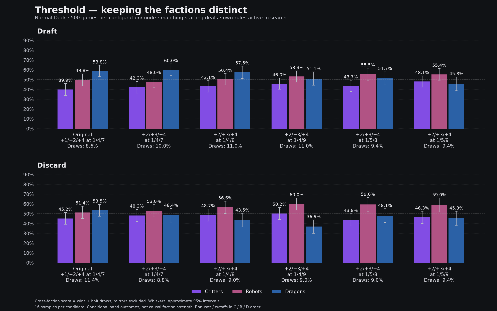

**Adopted after this study (2026-10-21):** the creator chose **+2/+3/+4 at 1/4/8** for the playable Threshold mode and closed tuning for now. Implemented in the shared scorer, AI and UI; V2 unchanged. The findings below describe the preceding evaluation.

# Threshold: distinct faction rewards

## Verdict: retain the distinction; no automatic adoption

Of the creator's two proposed cutoffs, **+2/+3/+4 at 1/4/8 is the safer compromise**. At 1/4/9, Draft looks closer (46.0% / 53.3% / 51.1%), but Discard swings to 50.2% / 60.0% / 36.9%. Moving Robots to cutoff 5 does not clearly improve the overall comparison. None of these results warrants calling Threshold balanced across both building modes. The playable Threshold remains +1/+2/+4 at 1/4/7 pending a design choice; Abilities v2 remains unchanged at Dragon 7+ → +4. Equal Critter/Robot bonus candidates will not be adopted. No upper-bound rule was implemented.

The 1/4/8 candidate scores **43.1% / 50.4% / 57.5% in Draft** and **48.7% / 56.6% / 43.5% in Discard**, with **11.0% / 9.0% draws**. Its actual faction wins are **147 / 165 / 133 Draft** and **183 / 173 / 99 Discard**. Other outcomes are draws or hands without a named faction. The earlier V2 reference had 4.6% / 7.4% draws and more even cross-faction scores; that reference uses different seeds and is context, not a matched-deal comparison in this chart.

**Why a Robot nerf can raise its conditional score:** with Dragon cutoff 8, moving Robot cutoff 4→5 reduces Robot presence from 361→286 hands in Draft and 328→252 in Discard. Actual Robot wins fall from 165→144 and 173→141, while cross-faction score rises from 50.4%→55.5% and 56.6%→59.6%. The policy builds/selects a different set of hands. This demonstrates why these conditional bars must be read alongside presence and actual wins; they are not direct causal measurements of faction strength.

Shields apply before Threshold eligibility. Dragon-main shield reduction is zero, so that ordering does not change Dragon eligibility. The relevant distinction from V2 is total hand power versus Dragon contribution. Changing Dragon cutoff 8→9 removes +4 from an 8-power hand without Shortcut; it is a substantial discrete change, not a small percentage nerf.

The equal-bonus trials are rejected on design grounds: Critters, Robots and Dragons should retain different reward curves. No Critter upper bound was implemented or tested. Abilities v2 stays at Dragon 7+ → +4.

The first comparison adds 3,000 Normal Deck games: +2/+3/+4 bonuses at 1/4/7, 1/4/8 and 1/4/9, each with 500 Draft and 500 Discard games. The original Threshold reference is another 1,000 games from the previously running confirmation. All configurations use the same starting deals (41m Draft / 42m Discard seeds), 16 search samples per candidate, and their own rules for choices and rollout scoring. These are exploratory candidates on this set, not independently confirmed selections.

| Bonuses | Cutoffs | Mode | Critters | Robots | Dragons | Draws |
|---|---|---|---:|---:|---:|---:|
| 1/2/4 | 1/4/7 | Draft | 39.9% | 49.8% | 58.8% | 8.6% |
| 1/2/4 | 1/4/7 | Discard | 45.2% | 51.4% | 53.5% | 11.4% |
| 2/3/4 | 1/4/7 | Draft | 42.3% | 48.0% | 60.0% | 10.0% |
| 2/3/4 | 1/4/7 | Discard | 48.3% | 53.0% | 48.4% | 8.8% |
| 2/3/4 | 1/4/8 | Draft | 43.1% | 50.4% | 57.5% | 11.0% |
| 2/3/4 | 1/4/8 | Discard | 48.7% | 56.6% | 43.5% | 9.0% |
| 2/3/4 | 1/4/9 | Draft | 46.0% | 53.3% | 51.1% | 11.0% |
| 2/3/4 | 1/4/9 | Discard | 50.2% | 60.0% | 36.9% | 9.0% |
| 2/3/4 | 1/5/8 | Draft | 43.7% | 55.5% | 51.7% | 9.4% |
| 2/3/4 | 1/5/8 | Discard | 43.8% | 59.6% | 48.1% | 9.0% |
| 2/3/4 | 1/5/9 | Draft | 48.1% | 55.4% | 45.8% | 9.4% |
| 2/3/4 | 1/5/9 | Discard | 46.3% | 59.0% | 45.3% | 9.4% |

Scores mean wins plus half draws against other named factions; same-faction matches are excluded. Rates describe hands selected by this search policy. They do not prove equal optimal-play strength.

## Hand counts

| Configuration | Mode | Faction | Hands | Wins | Draws | Losses | Cross-faction n | 95% interval |
|---|---|---|---:|---:|---:|---:|---:|---|
| threshold | draft | critter | 284 | 109 | 28 | 147 | 223 | 33.8%–46.0% |
| threshold | draft | robot | 320 | 148 | 29 | 143 | 230 | 43.6%–56.0% |
| threshold | draft | dragon | 372 | 200 | 27 | 145 | 261 | 53.0%–64.6% |
| threshold | five-hand-discard | critter | 364 | 153 | 44 | 167 | 230 | 39.2%–51.3% |
| threshold | five-hand-discard | robot | 303 | 148 | 27 | 128 | 219 | 45.1%–57.6% |
| threshold | five-hand-discard | dragon | 301 | 142 | 37 | 122 | 227 | 47.5%–59.6% |
| threshold-tuned | draft | critter | 332 | 133 | 34 | 165 | 240 | 36.3%–48.2% |
| threshold-tuned | draft | robot | 353 | 157 | 34 | 162 | 256 | 42.2%–53.9% |
| threshold-tuned | draft | dragon | 295 | 160 | 27 | 108 | 234 | 54.0%–66.1% |
| threshold-tuned | five-hand-discard | critter | 404 | 181 | 45 | 178 | 235 | 42.1%–54.5% |
| threshold-tuned | five-hand-discard | robot | 324 | 164 | 19 | 141 | 230 | 46.8%–59.3% |
| threshold-tuned | five-hand-discard | dragon | 243 | 111 | 19 | 113 | 191 | 41.5%–55.3% |
| threshold-distinct8 | draft | critter | 356 | 147 | 35 | 174 | 255 | 37.3%–48.9% |
| threshold-distinct8 | draft | robot | 361 | 165 | 37 | 159 | 264 | 44.6%–56.1% |
| threshold-distinct8 | draft | dragon | 261 | 133 | 34 | 94 | 221 | 51.2%–63.7% |
| threshold-distinct8 | five-hand-discard | critter | 404 | 183 | 44 | 177 | 236 | 42.6%–54.9% |
| threshold-distinct8 | five-hand-discard | robot | 328 | 173 | 23 | 132 | 228 | 50.3%–62.8% |
| threshold-distinct8 | five-hand-discard | dragon | 235 | 99 | 18 | 118 | 184 | 36.5%–50.4% |
| threshold-distinct9 | draft | critter | 378 | 162 | 41 | 175 | 260 | 40.3%–51.7% |
| threshold-distinct9 | draft | robot | 385 | 185 | 37 | 163 | 261 | 47.5%–59.0% |
| threshold-distinct9 | draft | dragon | 217 | 98 | 29 | 90 | 185 | 44.3%–57.9% |
| threshold-distinct9 | five-hand-discard | critter | 401 | 185 | 41 | 175 | 234 | 44.1%–56.4% |
| threshold-distinct9 | five-hand-discard | robot | 340 | 189 | 19 | 132 | 226 | 53.8%–66.1% |
| threshold-distinct9 | five-hand-discard | dragon | 226 | 81 | 24 | 121 | 176 | 30.1%–43.8% |
| threshold-later8 | draft | critter | 396 | 165 | 42 | 189 | 263 | 38.0%–49.5% |
| threshold-later8 | draft | robot | 286 | 144 | 26 | 116 | 227 | 49.3%–61.7% |
| threshold-later8 | draft | dragon | 292 | 144 | 22 | 126 | 230 | 45.5%–58.0% |
| threshold-later8 | five-hand-discard | critter | 468 | 201 | 57 | 210 | 226 | 37.5%–50.1% |
| threshold-later8 | five-hand-discard | robot | 252 | 141 | 11 | 100 | 183 | 52.6%–66.6% |
| threshold-later8 | five-hand-discard | dragon | 241 | 113 | 14 | 114 | 181 | 41.0%–55.1% |
| threshold-later9 | draft | critter | 425 | 189 | 46 | 190 | 267 | 42.3%–53.9% |
| threshold-later9 | draft | robot | 319 | 160 | 30 | 129 | 242 | 49.4%–61.4% |
| threshold-later9 | draft | dragon | 232 | 104 | 15 | 113 | 189 | 38.8%–52.7% |
| threshold-later9 | five-hand-discard | critter | 479 | 210 | 60 | 209 | 230 | 40.1%–52.5% |
| threshold-later9 | five-hand-discard | robot | 257 | 145 | 9 | 103 | 183 | 52.0%–66.0% |
| threshold-later9 | five-hand-discard | dragon | 221 | 98 | 17 | 106 | 171 | 38.2%–52.5% |

All games replayed with saved legal actions and exact final profiles/outcomes. Building and preparation search roots were recomputed in fresh processes and matched saved choices and candidate values. Source snapshots and manifests are retained. The earlier equal-bonus tests were allowed to finish; no runs were cancelled.

Earlier Battle/V2/card analysis: [Normal study](NORMAL_BALANCE_RESULTS.md). Rejected equal-bonus trials: [archive](THRESHOLD_REFINEMENT_RESULTS.md). Raw evidence: `.ai-runs/threshold-distinct-2026-10-21/` and `.ai-runs/threshold-confirmation-2026-10-21/`.

Follow-up: because Dragon cutoff 9 produced a large Robot advantage in Discard, an additional 2,000 games tested Robot cutoff 5 with Dragon cutoff 8 or 9, keeping bonuses +2/+3/+4. This was an adaptive exploratory step, not an independent holdout. Evidence is in `.ai-runs/threshold-later-2026-10-21/`.
