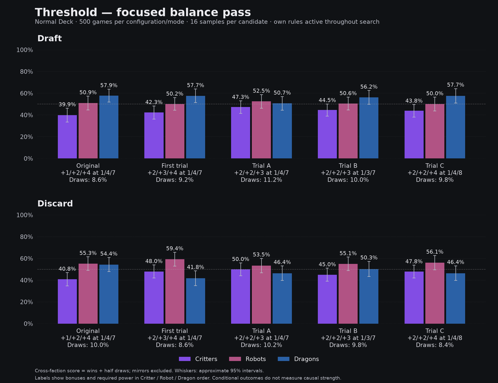
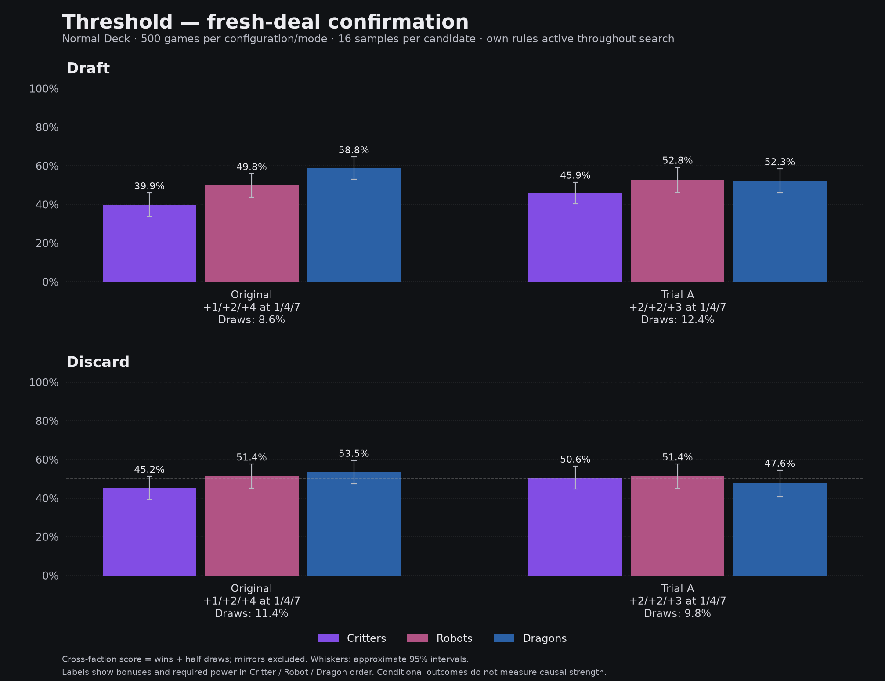

# Threshold refinement — Normal Deck

> Naming policy (2026-10-22): **Abilities = `abilities-main`** (formerly Abilities v2). The original is **Abilities Prototype** (`abilities-prototype`), hidden and excluded from balance testing unless explicitly requested. Generic tabletop requests mean main; Threshold must be named explicitly. Historical raw IDs/paths remain unchanged. See [ruleset naming policy](RULESET_NAMES.md).

Abilities v2 remains unchanged at Dragon7+ → +4. This pass targets a simple, reasonably balanced Threshold fallback.

**Superseded design direction:** the creator rejected equal Critter/Robot bonuses because they remove the distinct reward curves. Trial A was selected statistically before that correction; its already-running confirmation was allowed to finish, but it will not be adopted. The next comparison preserves +2/+3/+4 and tests Dragon cutoffs 8 and 9 against 7. No Critter upper bound is being implemented or tested. Abilities v2 remains unchanged.

## Calibration

Three candidates, 500 Draft + 500 Discard games each, on the previous31m/32m seeds. All use their own scoring parameters throughout actual search and all rollout/preparation evaluation, with the same16-sample budget. Earlier original/first-trial results are shown for context; no Wild games are included.

| Configuration | Building | Critters | Robots | Dragons | Draws |
|---|---|---:|---:|---:|---:|
| Original +1/+2/+4 at 1/4/7 | Draft | 39.9% | 50.9% | 57.9% | 8.6% |
| Original +1/+2/+4 at 1/4/7 | Discard | 40.8% | 55.3% | 54.4% | 10.0% |
| First trial +2/+3/+4 at 1/4/7 | Draft | 42.3% | 50.2% | 57.7% | 9.2% |
| First trial +2/+3/+4 at 1/4/7 | Discard | 48.0% | 59.4% | 41.8% | 8.6% |
| Trial A +2/+2/+3 at 1/4/7 | Draft | 47.3% | 52.5% | 50.7% | 11.2% |
| Trial A +2/+2/+3 at 1/4/7 | Discard | 50.0% | 53.5% | 46.4% | 10.2% |
| Trial B +2/+2/+3 at 1/3/7 | Draft | 44.5% | 50.6% | 56.2% | 10.0% |
| Trial B +2/+2/+3 at 1/3/7 | Discard | 45.0% | 55.1% | 50.3% | 9.8% |
| Trial C +2/+2/+4 at 1/4/8 | Draft | 43.8% | 50.0% | 57.7% | 9.8% |
| Trial C +2/+2/+4 at 1/4/8 | Discard | 47.8% | 56.1% | 46.4% | 8.4% |

## Selection before fresh-deal testing

Select Trial A: bonuses +2/+2/+3 at power 1/4/7. Across both calibration modes, all faction point estimates lie between 46.4% and 53.5%, a smaller spread than the other candidates. Robot cutoff3 and retaining Dragon+4 at8 did not improve the overall spread. The explicit tradeoff is draws11.2% Draft/10.2% Discard, versus original8.6%/10.0%. Treat this as a simple balanced backup, not a replacement for V2. Confirm against original Threshold on fresh41m/42m deals before adoption.

Selected: `threshold-balanced`. Selection recorded before launching the confirmation games. Confirmation uses fresh41m/42m seeds, comparing the selected candidate against the original Threshold on matching starting deals; no calibration games are pooled into confirmation.

## Fresh-deal confirmation

| Configuration | Building | Critters | Robots | Dragons | Draws |
|---|---|---:|---:|---:|---:|
| Original +1/+2/+4 at 1/4/7 | Draft | 39.9% | 49.8% | 58.8% | 8.6% |
| Original +1/+2/+4 at 1/4/7 | Discard | 45.2% | 51.4% | 53.5% | 11.4% |
| Trial A +2/+2/+3 at 1/4/7 | Draft | 45.9% | 52.8% | 52.3% | 12.4% |
| Trial A +2/+2/+3 at 1/4/7 | Discard | 50.6% | 51.4% | 47.6% | 9.8% |

## Faction counts and uncertainty

| Stage | Configuration | Building | Faction | Hands | Wins / draws / losses | Cross-faction score [95% interval] |
|---|---|---|---|---:|---:|---:|
| Calibration | threshold-balanced | draft | critter | 392 | 170 / 43 / 179 | 47.3% [41.5%, 53.1%] (n=257) |
| Calibration | threshold-balanced | draft | robot | 313 | 143 / 41 / 129 | 52.5% [46.3%, 58.8%] (n=218) |
| Calibration | threshold-balanced | draft | dragon | 282 | 131 / 26 / 125 | 50.7% [44.4%, 57.0%] (n=221) |
| Calibration | threshold-balanced | five-hand-discard | critter | 433 | 202 / 40 / 191 | 50.0% [44.1%, 55.9%] (n=253) |
| Calibration | threshold-balanced | five-hand-discard | robot | 304 | 147 / 31 / 126 | 53.5% [46.9%, 60.0%] (n=202) |
| Calibration | threshold-balanced | five-hand-discard | dragon | 233 | 100 / 25 / 108 | 46.4% [39.6%, 53.1%] (n=193) |
| Calibration | threshold-balanced-robot3 | draft | critter | 383 | 160 / 37 / 186 | 44.5% [39.0%, 50.1%] (n=275) |
| Calibration | threshold-balanced-robot3 | draft | robot | 338 | 154 / 36 / 148 | 50.6% [44.7%, 56.5%] (n=247) |
| Calibration | threshold-balanced-robot3 | draft | dragon | 268 | 136 / 25 / 107 | 56.2% [49.9%, 62.5%] (n=218) |
| Calibration | threshold-balanced-robot3 | five-hand-discard | critter | 395 | 172 / 40 / 183 | 45.0% [38.9%, 51.0%] (n=239) |
| Calibration | threshold-balanced-robot3 | five-hand-discard | robot | 362 | 180 / 33 / 149 | 55.1% [48.9%, 61.2%] (n=227) |
| Calibration | threshold-balanced-robot3 | five-hand-discard | dragon | 214 | 99 / 23 / 92 | 50.3% [43.3%, 57.3%] (n=176) |
| Calibration | threshold-balanced-dragon8 | draft | critter | 401 | 168 / 44 / 189 | 43.8% [38.1%, 49.6%] (n=260) |
| Calibration | threshold-balanced-dragon8 | draft | robot | 301 | 133 / 38 / 130 | 50.0% [43.6%, 56.4%] (n=212) |
| Calibration | threshold-balanced-dragon8 | draft | dragon | 277 | 150 / 12 / 115 | 57.7% [51.1%, 64.3%] (n=208) |
| Calibration | threshold-balanced-dragon8 | five-hand-discard | critter | 438 | 200 / 36 / 202 | 47.8% [41.9%, 53.7%] (n=254) |
| Calibration | threshold-balanced-dragon8 | five-hand-discard | robot | 300 | 154 / 25 / 121 | 56.1% [49.5%, 62.6%] (n=206) |
| Calibration | threshold-balanced-dragon8 | five-hand-discard | dragon | 238 | 104 / 20 / 114 | 46.4% [39.7%, 53.1%] (n=196) |
| Confirmation | threshold | draft | critter | 284 | 109 / 28 / 147 | 39.9% [33.8%, 46.0%] (n=223) |
| Confirmation | threshold | draft | robot | 320 | 148 / 29 / 143 | 49.8% [43.6%, 56.0%] (n=230) |
| Confirmation | threshold | draft | dragon | 372 | 200 / 27 / 145 | 58.8% [53.0%, 64.6%] (n=261) |
| Confirmation | threshold | five-hand-discard | critter | 364 | 153 / 44 / 167 | 45.2% [39.2%, 51.3%] (n=230) |
| Confirmation | threshold | five-hand-discard | robot | 303 | 148 / 27 / 128 | 51.4% [45.1%, 57.6%] (n=219) |
| Confirmation | threshold | five-hand-discard | dragon | 301 | 142 / 37 / 122 | 53.5% [47.5%, 59.6%] (n=227) |
| Confirmation | threshold-balanced | draft | critter | 412 | 173 / 54 / 185 | 45.9% [40.3%, 51.5%] (n=256) |
| Confirmation | threshold-balanced | draft | robot | 270 | 125 / 36 / 109 | 52.8% [46.2%, 59.3%] (n=199) |
| Confirmation | threshold-balanced | draft | dragon | 293 | 140 / 31 / 122 | 52.3% [46.0%, 58.5%] (n=221) |
| Confirmation | threshold-balanced | five-hand-discard | critter | 460 | 211 / 53 / 196 | 50.6% [44.6%, 56.6%] (n=247) |
| Confirmation | threshold-balanced | five-hand-discard | robot | 282 | 136 / 25 / 121 | 51.4% [45.1%, 57.7%] (n=218) |
| Confirmation | threshold-balanced | five-hand-discard | dragon | 231 | 104 / 16 / 111 | 47.6% [40.7%, 54.5%] (n=187) |

Normal Deck and real mode-specific search are verified in manifests and reproducible source snapshots. Every actual game was replayed; building and preparation search roots were recomputed under each variant and matched saved candidate values/actions. Draft starters alternate. Discard retains the existing local sequential flow and recycle semantics. Group rates describe selected hands, not optimal play or equal causal faction strength.

Full earlier Battle/V2 comparison and card tables: [Normal balance study](NORMAL_BALANCE_RESULTS.md). Raw calibration/confirmation evidence lives in `.ai-runs/threshold-refinement-2026-10-21/` and `.ai-runs/threshold-confirmation-2026-10-21/`.
