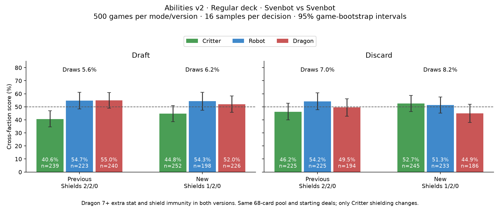

# Critter shield -1 follow-up — 2026-10-22

| Mode | Version | Critters | Robots | Dragons | Draws |
|---|---|---:|---:|---:|---:|
| Draft | Previous: shields 2/2/0 | 40.6% | 54.7% | 55.0% | 5.6% |
| Draft | New: shields 1/2/0 | 44.8% | 54.3% | 52.0% | 6.2% |
| Discard | Previous: shields 2/2/0 | 46.2% | 54.2% | 49.5% | 7.0% |
| Discard | New: shields 1/2/0 | 52.7% | 51.3% | 44.9% | 8.2% |

Cross-faction wins plus half draws, mirrors excluded; 95% whole-game bootstrap intervals, 3000 replicates.

Same current card pool and identical starting deals verified. Only Critter shield cost changes, 2 to 1. Previous data reused; no new control run.

Both versions keep Dragon contribution 7+ before shields adding exactly one stat, Dragon shield immunity, Robot Perfect Balance and Critter ties. New shield costs C/R/D: 1/2/0. Svenbot search and all rollouts use their own variant rules. All 1,000 new games replayed; four building/preparation roots recomputed exactly. The creator later adopted this ruleset (Abilities main; Dragon 7+, shields C/R/D 1/2/0).

