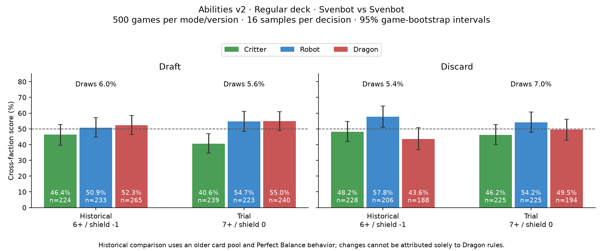

# Dragon 7+ and shield immunity trial — 2026-10-22

| Mode | Version | Critters | Robots | Dragons | Draws |
|---|---|---:|---:|---:|---:|
| Draft | Historical 6+ / shield -1 | 46.4% | 50.9% | 52.3% | 6.0% |
| Draft | Trial 7+ / shield 0 | 40.6% | 54.7% | 55.0% | 5.6% |
| Discard | Historical 6+ / shield -1 | 48.2% | 57.8% | 43.6% | 5.4% |
| Discard | Trial 7+ / shield 0 | 46.2% | 54.2% | 49.5% | 7.0% |

Cross-faction wins plus half draws, mirrors excluded; 95% whole-game bootstrap intervals, 3000 replicates.

Historical data includes Chameleon and C+R+D and predates the zero-damage product Perfect Balance fix. Different pools/deals: not a paired or isolated rule comparison.

Current v2 regular deck (68 cards), Perfect Balance, Critter ties, shields C/R/D 2/2/0; Dragon contribution 7+ before shields adds exactly one stat. Each search and rollout uses the trial rules. No new control run. All 1,000 games replayed; four actual building/preparation search roots recomputed exactly. The creator later adopted Dragon 7+ with C/R/D shields 1/2/0 as Abilities main; the 2/2/0 shield configuration in this trial was not adopted.

