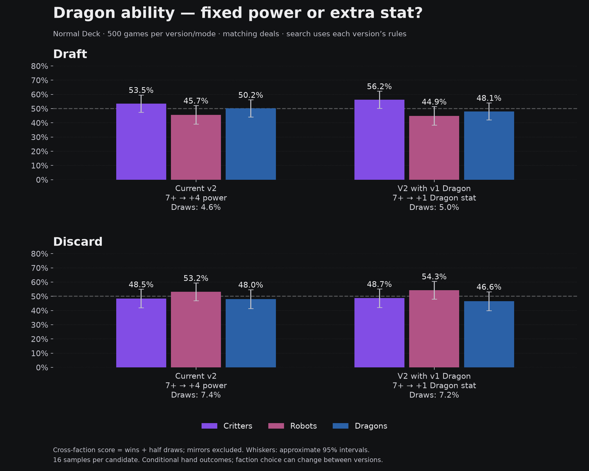

# V2 with the v1 Dragon ability — 2026-10-21

**Verdict:** the extra-stat version appears slightly weaker for Dragons here, with no demonstrated balance improvement. Dragon cross-faction score falls 2.1 percentage points in Draft and 1.4 in Discard; both paired 95% intervals include zero. Draft shifts toward Critters and Discard toward Robots. Keep +4 as the working default on this evidence; this trial is not adopted.

Only Dragon Overwhelming changes: 7+ Dragon contribution grants one extra Dragon stat, once, instead of +4 power. Critter tiebreak and Robot Reconfigure remain v2. The extra stat recomputes ultimates and hybrid formulas before shields and main-faction selection. Reconfigure compares plans using the experimental rule.

1,000 new games versus 1,000 archived baseline games: 500 per version/mode, Normal Deck, both seats using browser search with 16 samples per candidate and preparation lookahead. Starting deals, first pickers and planning seeds match. These are separate self-play environments, not one version playing directly against the other. Local sequential Discard semantics apply.



## Cross-faction score (same metric as the supplied chart)

Score = (wins + half draws) / games against another named faction. Mirrors and untyped opponents excluded. This measures selected-hand outcomes, not causal faction strength.

| Mode | Dragon rule | Critters | Robots | Dragons | Draws |
|---|---|---:|---:|---:|---:|
| Draft | +4 power | 53.5% | 45.7% | 50.2% | 4.6% |
| Draft | +1 Dragon stat | 56.2% | 44.9% | 48.1% | 5.0% |
| Discard | +4 power | 48.5% | 53.2% | 48.0% | 7.4% |
| Discard | +1 Dragon stat | 48.7% | 54.3% | 46.6% | 7.2% |

## Actual wins when that faction is played

Includes mirrors and draws in the denominator; both mirror hands count as faction appearances. These percentages therefore differ from the cross-faction score.

| Mode | Dragon rule | Critters W / hands | Robots W / hands | Dragons W / hands |
|---|---|---:|---:|---:|
| Draft | +4 power | 190/377 (50.4%) | 120/271 (44.3%) | 167/348 (48.0%) |
| Draft | +1 Dragon stat | 198/377 (52.5%) | 119/276 (43.1%) | 158/342 (46.2%) |
| Discard | +4 power | 182/399 (45.6%) | 156/311 (50.2%) | 125/278 (45.0%) |
| Discard | +1 Dragon stat | 182/398 (45.7%) | 159/311 (51.1%) | 123/278 (44.2%) |

## Cross-faction change and uncertainty

Extra stat minus fixed power, in percentage points. Approximate 95% paired bootstrap intervals resample 500 matched deals (5,000 replicates); membership may change with search choices. These deals were used previously and are not a fresh holdout.

| Mode | Faction | Change | 95% interval |
|---|---|---:|---:|
| draft | critter | +2.7 | +0.2 to +5.3 |
| draft | robot | -0.8 | -3.0 to +1.4 |
| draft | dragon | -2.1 | -4.6 to +0.3 |
| five-hand-discard | critter | +0.2 | -0.8 to +1.4 |
| five-hand-discard | robot | +1.1 | -0.2 to +2.6 |
| five-hand-discard | dragon | -1.4 | -3.3 to +0.3 |

## Mechanical check: keep baseline final cards fixed

Automatic Reconfigure and faction choice are recomputed, but no cards are redrafted/discarded. This isolates the scoring change from new search choices; it is not additional self-play.

| Mode | Activated baseline hands | Weaker / equal / stronger score | Mean score change when active | Changed game outcomes | Draws before → after |
|---|---:|---:|---:|---:|---:|
| draft | 91 | 41 / 40 / 10 | -0.48 | 3/500 | 23 → 23 |
| five-hand-discard | 28 | 13 / 13 / 2 | -0.64 | 0/500 | 37 → 37 |

## Evidence and reproduction

Raw evidence: `.ai-runs/v2-dragon-stat-2026-10-21/`; baseline `.ai-runs/normal-balance-2026-10-21/abilitiesv2-*-normal-16/`. Every new game is replayed, sampled building/preparation roots are recomputed, and baseline replays verify default behavior remains identical. `verification.json`, `analysis.json` and `same-hands.json` preserve checks and detailed counts. Source snapshots and hashes accompany collection.

Commands (use a fresh output directory for collection; the runner preserves existing evidence):

```powershell
node scripts/run-normal-balance.mjs .ai-runs/v2-dragon-stat-2026-10-21 500 16 2 abilitiesv2-extra-stat 31000000
node scripts/verify-normal-balance.mjs .ai-runs/v2-dragon-stat-2026-10-21
node scripts/verify-v2-dragon-stat.mjs
node scripts/rescore-v2-dragon-stat.mjs
.ai-venv/Scripts/python.exe scripts/analyze-v2-dragon-stat.py
```

The process-local trial is configured before any cached profiles are created. Playable v2 still defaults to +4 power; no design adoption or publishing is implied.
